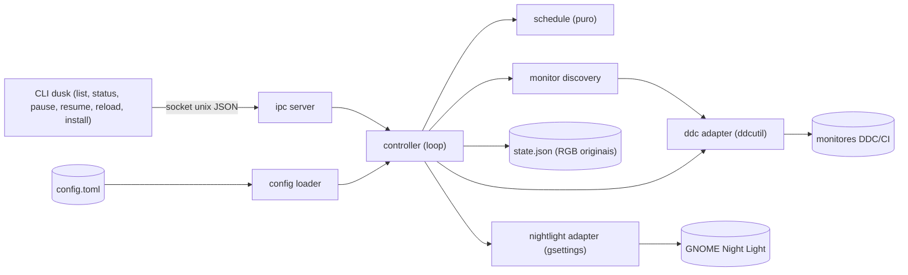
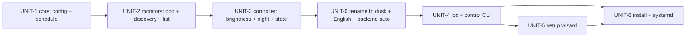
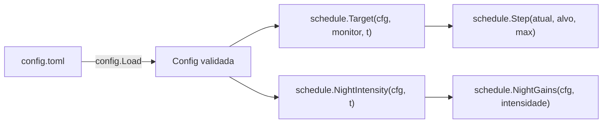
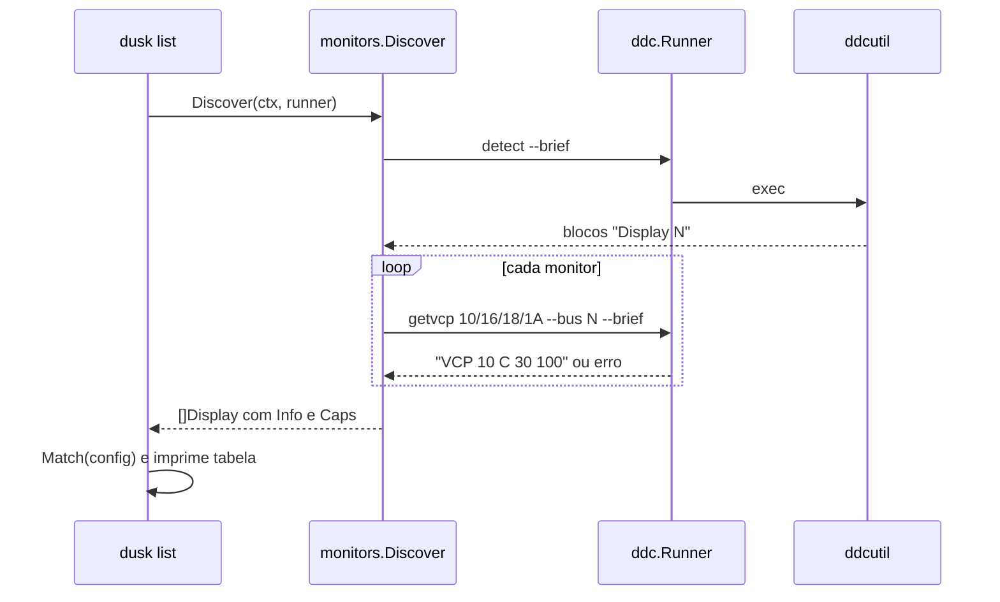
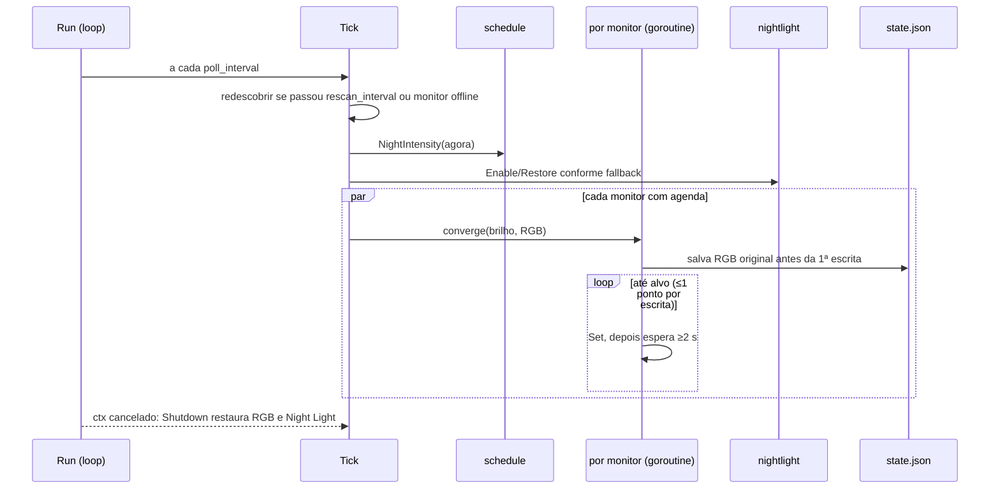
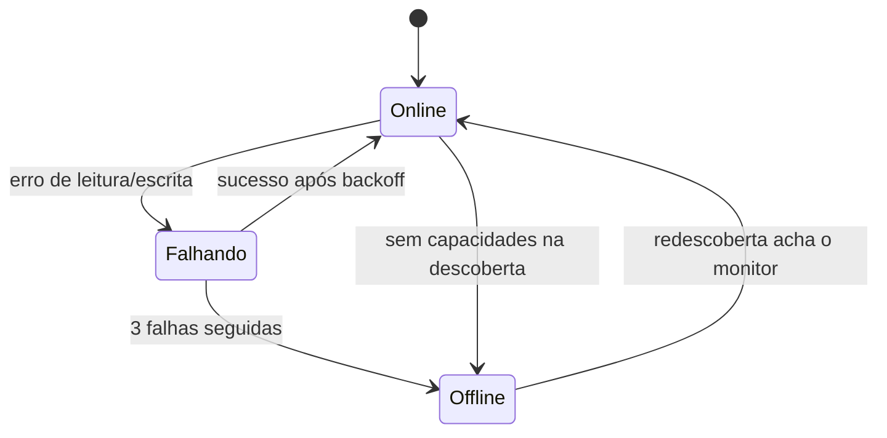
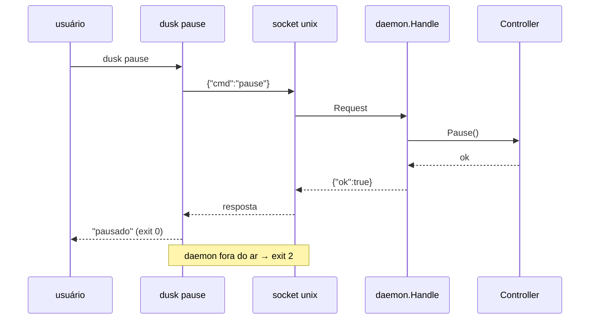
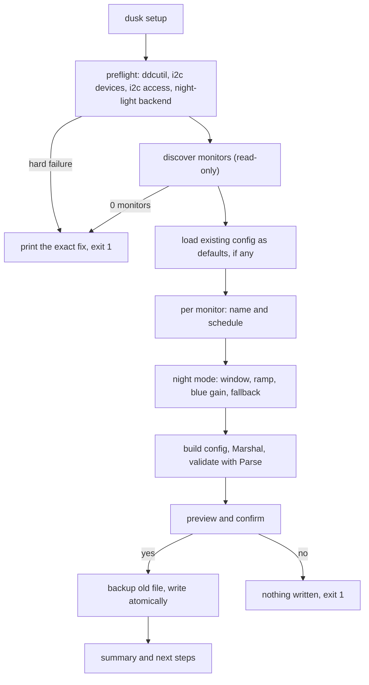
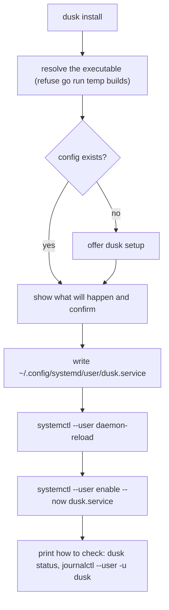

# Design — display-brightness-scheduler

## 2.1 Codebase analysis
## 2.2 Team practices

Greenfield: sem evidência no repo; práticas vêm da entrevista com o usuário.

| Prática | Decisão | Fonte |
|---|---|---|
| Linguagem | Go (go1.26.8 instalado) | [user] "Go" |
| Controle de versão | `git init` local (branch `master`); sem commit/push automático | [user] |
| Configuração | Arquivo TOML em `~/.config`, editável à mão | [user] |
| Testes | Escrever testes (framework padrão `go test`) | [user] "Escrever testes, mas escolhi a linguagem Go" |
| Lint/format | `gofmt` + `go vet` (padrão da toolchain) | [inferred] |
| Repository language | English for code, comments, messages, logs, README and generated TOML; `.aidlc` follows the user (pt-BR) | [user] M-003 |
| Task runner | `justfile` na raiz; `just check` embrulha o comando de verificação aprovado | [user] "use justfile no projeto também" |

### Evidência do ambiente (probe de preflight)

- Ubuntu, GNOME Shell 50.1 em Wayland; `xrandr` só enxerga XWayland, então não serve para brilho.
- `ddcutil detect` encontra 3 monitores com DDC/CI: AOC 24G4 (bus 5, DP-1), LG ULTRAWIDE (bus 7, HDMI-A-1), Samsung LF24T450F (bus 8, DP-3).
- VCP 0x10 (brilho) responde nos três (valores atuais 30/40/25, máx. 100). AOC e LG anunciam ganhos RGB (0x16/0x18/0x1A); o AOC também anuncia 0x0C. A capability do Samsung não foi lida no probe.
- GNOME Night Light existe (`NightLightSupported = true`), mas é global e usa gamma.

### Assumptions & open questions
- A-2.2.1: lint = `gofmt`/`go vet`; sem golangci-lint. [inferred, a confirmar no gate]
## 2.6 Domain & components

Um binário Go (`dusk`) com pacotes internos. A lógica de tempo é pura (relógio injetado) e todo acesso ao mundo externo passa por interfaces mockáveis (NFR-2).



Caption: o controller liga agenda pura, descoberta e adaptadores de hardware; o CLI conversa com o daemon por socket.

### Components

| Componente | Responsabilidade | Interfaces | Dados |
|---|---|---|---|
| `config` | Ler, validar e normalizar o TOML (monitores, pontos-chave, noturno, intervalos) | `Load(path) (Config, error)` | `~/.config/dusk/config.toml` |
| `schedule` | Função pura: dado `Config`, monitor e instante, devolve brilho alvo e intensidade noturna (0–1) | `Target(cfg, mon, t)` | nenhum |
| `ddc` | Adaptador de `ddcutil`: detect, getvcp, setvcp, whitelist de VCP, clamp de valores | interface `Display` | nenhum |
| `monitors` | Identidade (modelo+serial), capacidades, redeteção periódica | `Discover()`, `Match(cfg)` | em memória |
| `nightlight` | Liga/desliga Night Light do GNOME via `gsettings` e lembra se foi ele que ligou | interface `NightLight` | `state.json` |
| `state` | Persistir ganhos RGB originais e flags | `Save/Load` | `~/.local/state/dusk/state.json` |
| `controller` | Loop com tick, aplica passos, retry/backoff, pause/resume, reload | `Run(ctx)` | em memória |
| `ipc` | Servidor/cliente por socket unix em `$XDG_RUNTIME_DIR/dusk.sock` | comandos JSON | nenhum |
| `cmd/dusk` | CLI, `install` (unit systemd + TOML de exemplo) | subcomandos | unit em `~/.config/systemd/user/` |

### Decisions

#### ADR-1 Usar `ddcutil` como subprocesso — Status: accepted
- Context: precisamos de DDC/CI nos 3 monitores; o `ddcutil detect` já funciona sem sudo.
- Decision: chamar `ddcutil` (`detect --brief`, `getvcp`, `setvcp`) com `--bus` e `--noverify` quando útil.
- Alternatives: ioctl I2C direto em Go (reimplementar quirks de DDC e EDID); libddcutil via cgo (build mais difícil).
- Consequences: dependência externa obrigatória; latência por chamada (~100 ms a 1 s); o adaptador isola isso. Related: FR-2, FR-6, NFR-7.

#### ADR-2 Agenda como função pura com relógio injetado — Status: accepted
- Context: precisamos de testes sem hardware e sem esperar horas (NFR-2, NFR-8).
- Decision: `schedule.Target` é puro; o controller injeta `clock` e o adaptador `Display`.
- Alternatives: temporizadores por monitor com estado interno (difíceis de testar).
- Consequences: o controller só decide *quando escrever*; o cálculo é testável em tabela. Related: FR-5, FR-7, NFR-8.

#### ADR-3 Modo noturno = ganho RGB via DDC, com Night Light como fallback global — Status: accepted
- Context: o usuário escolheu "os dois combinados". Night Light é global e atua por gamma; DDC é por monitor.
- Decision: monitores com RGB recebem o ganho azul reduzido; se ≥1 monitor ativo não tem RGB (ou falha), liga-se o Night Light com temperatura derivada da intensidade. O Night Light afeta todos, então empilha com o DDC nos monitores com RGB.
- Alternatives: só DDC (deixa monitores sem RGB sem filtro); só Night Light (sem controle por monitor).
- Consequences: possível efeito duplo nos monitores com RGB; mitigado por `night.fallback = "auto" | "off"` e por reduzir a intensidade DDC quando o fallback está ligado (A-8). Related: FR-8, FR-9, FR-10.

#### ADR-4 Controle por socket unix — Status: accepted
- Context: `pause/resume/status/reload` precisam falar com o daemon em execução.
- Decision: socket em `$XDG_RUNTIME_DIR/dusk.sock`, JSON por linha, permissão 0600.
- Alternatives: sinais (sem resposta/estado); D-Bus (mais pesado).
- Consequences: `status` rico e simples de testar. Related: FR-12, FR-13.

#### ADR-5 Persistir ganhos RGB originais — Status: accepted
- Context: se o daemon cair no meio do modo noturno, o monitor ficaria amarelo para sempre.
- Decision: antes da primeira alteração de RGB, ler e gravar o valor em `state.json`; no start, se houver estado e a agenda diz "dia", restaurar.
- Alternatives: assumir 100/100/100 (errado para monitores calibrados).
- Consequences: arquivo de estado pequeno; restauração segura após crash. Related: FR-10, NFR-4.

#### ADR-6 TOML com `github.com/BurntSushi/toml` — Status: accepted
- Context: Go não tem TOML na stdlib; requisito de TOML foi do usuário.
- Decision: usar BurntSushi/toml (madura, estável).
- Consequences: única dependência Go (NFR-7). Related: FR-13.

### Assumptions & open questions
- A-8: com fallback Night Light ligado, a intensidade DDC dos monitores com RGB é reduzida pela metade para evitar efeito duplo. [inferred]
- A-9: `ddcutil` leva até ~1 s por chamada; o tick padrão é de 30 s e escreve só quando o inteiro muda. [inferred]

## 2.7 Units of work



Caption: ordem topológica UNIT-1 → UNIT-6; DAG acíclico, cada seta é dependência de código.

### UNIT-1 Core: config e agenda
- Purpose: TOML validado e função pura de agenda (brilho alvo e intensidade noturna).
- Covers: FR-5, FR-7, FR-13 (validação), NFR-1, NFR-8, US-3 (AC1, AC3 em parte).
- Scope in: módulo Go, `config`, `schedule`, relógio injetável. Out: qualquer I/O de hardware.
- Interfaces: `config.Load`, `schedule.Target`.
- Depends on: nenhuma.
- DoD: verification command passa; tabela de testes cobre interpolação circular, viradas de meia-noite, rampa e DST.

### UNIT-2 Monitores: adaptador ddcutil e descoberta
- Purpose: enxergar os monitores reais e ler/escrever VCP com segurança.
- Covers: FR-2, FR-4, NFR-2, US-2 (AC1, AC3).
- Scope in: `ddc`, `monitors`, whitelist de VCP, clamp, `dusk list` (somente leitura) como primeiro slice ponta a ponta. Out: loop de aplicação.
- Interfaces: `Display`, `Discover`, `Match`.
- Depends on: UNIT-1 (config para casar apelidos).
- DoD: testes com `ddcutil` falso (script) passam; `dusk list` real mostra os 3 monitores.

### UNIT-3 Controller: brilho, modo noturno e estado
- Purpose: aplicar agenda e modo noturno com passos pequenos, restaurar RGB, fallback Night Light, resiliência.
- Covers: FR-3, FR-6, FR-8, FR-9, FR-10, FR-11, NFR-1, NFR-3, NFR-4, NFR-5, US-2 (AC2), US-3 (AC2), US-4.
- Scope in: `controller`, `nightlight`, `state`, backoff e redeteção. Out: IPC.
- Interfaces: `controller.Run(ctx)`, `NightLight`, `state`.
- Depends on: UNIT-1, UNIT-2.
- DoD: testes com mocks provam passos ≤1 ponto, restauração, fallback e backoff; NFR-2 asserção de whitelist.

### UNIT-4 IPC e CLI de controle
- Purpose: parar/pausar/consultar e recarregar o daemon.
- Covers: FR-12, FR-13 (reload), US-5.
- Scope in: `ipc`, subcomandos `run|status|pause|resume|reload|list`. Out: instalação.
- Depends on: UNIT-3.
- DoD: teste de integração por socket em diretório temporário.

### UNIT-6 Instalação e systemd
- Purpose: autostart e configuração inicial.
- Covers: FR-1, FR-14, NFR-6, NFR-7, US-1.
- Scope in: `dusk install`/`uninstall`, geração de unit e TOML de exemplo, README. Out: pacote .deb.
- Depends on: UNIT-4.
- DoD: testes de geração de arquivos em diretório temporário; instalação real só com aprovação explícita no momento.

### Story → Unit map

| Story | Unit(s) |
|---|---|
| US-1 | UNIT-6 |
| US-2 | UNIT-2, UNIT-3 |
| US-3 | UNIT-1, UNIT-3 |
| US-4 | UNIT-1, UNIT-3 |
| US-5 | UNIT-4 |

Nota de posse: cada FR tem um Unit dono: FR-5,7→U1; FR-2,4→U2; FR-3,6,8,9,10,11→U3; FR-12,13→U4 (FR-13 validação em U1); FR-1,14→U6.

### Assumptions & open questions
- A-10: rampa de entrada = [início, início+rampa]; rampa de saída = [fim, fim+rampa]. [inferred]

## 2.8 Contracts

### config.toml

```toml
poll_interval   = "30s"
rescan_interval = "5m"

[night]
enabled    = true
start      = "21:00"
end        = "07:00"
ramp       = "30m"
blue_gain  = 60          # % do ganho azul original no auge
red_gain   = 100
green_gain = 100
fallback   = "auto"      # "auto" | "off"

[[monitor]]
name  = "aoc"
match = "24G4"           # "modelo" ou "modelo#serial" (modelo do EDID)
points = [
  { time = "08:00", brightness = 70 },
  { time = "18:00", brightness = 40 },
  { time = "22:00", brightness = 20 },
]
```

Erros: horário fora de HH:MM, brilho fora de 0–100, apelido duplicado, `match` repetido e lista de pontos vazia são rejeitados com linha.

### Interface de hardware (Go)

```go
type Display interface {
    ID() MonitorID                       // modelo + serial + bus
    Caps() Caps                          // Brightness, RGB bool; máximos
    Get(vcp VCP) (cur, max int, err error)
    Set(vcp VCP, v int) error            // só 0x10, 0x16, 0x18, 0x1A
}
type NightLight interface { Set(enabled bool, kelvin int) error; Owned() bool }
```

### IPC (socket unix, JSON por linha)

| Requisição | Resposta |
|---|---|
| `{"cmd":"status"}` | `{"ok":true,"paused":false,"monitors":[{"name":"aoc","target":30,"night":0.5,"last_error":""}]}` |
| `{"cmd":"pause"}` / `{"cmd":"resume"}` / `{"cmd":"reload"}` | `{"ok":true}` ou `{"ok":false,"error":"..."}` |

`pause` apenas congela as escritas (brilho e RGB ficam como estão). Parar o serviço (`systemctl --user stop`, SIGTERM) restaura o RGB original antes de sair.

### state.json

```json
{"version":1,"originals":{"24G4#SN123":{"r":100,"g":100,"b":100}},"nightlight_original":null}
```

### Erro e versionamento
Códigos de saída do CLI: 0 ok, 1 erro de uso/config, 2 daemon inacessível. `state.json` e IPC carregam `version`.

### Assumptions & open questions
- A-11: `dusk stop` = alias de `systemctl --user stop dusk` e restaura RGB original antes de sair. [inferred]

## 3.1–3.3 UNIT-1 — Core: config e agenda (design funcional, NFR e mecanismos)

Escopo desta Unit: pacotes `internal/config` e `internal/schedule`, sem I/O de hardware, mais `go.mod` e `justfile`. Decisões de 3.4 (infra): não se aplica a esta Unit (sem recursos); o `justfile` é só ferramenta de desenvolvimento.



Caption: `Load` produz uma `Config` imutável; as funções de `schedule` são puras e recebem o instante `t`.

### Entidades

| Tipo | Campos |
|---|---|
| `Config` | `PollInterval`, `RescanInterval` (`time.Duration`), `Night`, `Monitors []Monitor` |
| `Night` | `Enabled`, `Start`, `End` (minutos desde 00:00), `Ramp`, `BlueGain`, `RedGain`, `GreenGain` (0–100), `Fallback` (`gnome` ou `off`) |
| `Monitor` | `Name`, `Match` (modelo ou modelo#serial), `Points []Point` ordenados por horário |
| `Point` | `Minute` (0–1439), `Brightness` (0–100) |

Padrões: `poll_interval=30s`, `rescan_interval=5m`, `night.ramp=30m`, `blue_gain=60`, `red_gain=green_gain=100`, `fallback="auto"`, `night.enabled=true`.

### Regras

- **Interpolação (FR-5):** com os pontos ordenados, o ponto anterior ao instante `m` (minutos fracionários, incluindo segundos) é o último com `Minute ≤ m`, ou o último da lista se nenhum (virada da meia-noite); o seguinte é o próximo na lista circular. Se o seguinte for ≤ anterior, soma-se 1440 ao seguinte (e a `m` se necessário). `brilho = b1 + (b2-b1) × (m-m1)/(m2-m1)`. Um único ponto vale constante. O resultado é arredondado ao inteiro mais próximo.
- **Intensidade noturna (FR-7):** `s` = início, `e` = fim, `r` = rampa, tudo em minutos módulo 1440. Subida em `[s, s+r]`: `(m-s)/r`; platô 1 em `[s+r, e]`; descida em `[e, e+r]`: `1-(m-e)/r`; 0 fora disso. Com `enabled=false`, sempre 0.
- **Ganhos (FR-8):** `ganho_canal = 100 - intensidade × (100 - canal_alvo)`, arredondado. O controller aplica `ganho% × RGB_original`.
- **Passo (FR-6, NFR-1):** `Step(atual, alvo, max)` aproxima `atual` do `alvo` em no máximo `max` pontos e devolve o novo valor; igual ao atual significa nenhuma escrita.
- **Validação (FR-13):** erros agregados com o caminho do campo: horário fora de `HH:MM`, brilho fora de 0–100, ganhos fora de 0–100, apelido ou `match` duplicados, monitor sem pontos, dois pontos no mesmo horário, `fallback` desconhecido, duração ≤0, chaves desconhecidas (detecta typo). Janela noturna: `start≠end`; rampa ≤ duração da janela, e rampa ≤ 1440 − duração da janela (a rampa de saída não invade a próxima subida).

### Casos de erro e limites
- Arquivo ausente: `Load` devolve erro de `os`; quem chama decide gerar o padrão. Config inválida: lista de todos os erros, sem config parcial.
- Hora local: usa `time.Time` local do relógio injetado. Em mudança de DST o salto máximo é de 1 h no relógio de parede, aceito e testado (NFR-8).

### NFR da Unit

| ID | Alvo | Verificação |
|---|---|---|
| NFR-1 | Passo ≤`max` (1) por chamada; rampa de 20 pontos gera ≤20 escritas | tabela em `schedule_test` |
| NFR-8 | Erro de interpolação ≤0,5 ponto vs. fórmula; sem saltos na virada de meia-noite | tabela + teste de propriedade simples (monotonicidade entre pontos) |
| NFR-8.1 | `Load` + `Target` processam 1000 chamadas/ms sem alocar em `Target` além de uma struct | benchmark informativo |
| NFR-7 | Única dependência externa: `github.com/BurntSushi/toml` | `go.mod` |

### Mecanismos
Funções puras com relógio injetado (ADR-2); `Config` imutável após `Load`; duração via `time.ParseDuration` num tipo com `UnmarshalText`; chaves não decodificadas (`MetaData.Undecoded`) viram erro.

### Assumptions & open questions
- A-12: módulo Go chamado `dusk` (sem caminho de GitHub), já que o projeto é local. [inferred]
- A-13: `Target` devolve `(int, bool)` com `false` para monitor sem pontos; a validação já impede isso. [inferred]

## 3.1–3.3 UNIT-2 — Monitores: adaptador ddcutil e descoberta

Escopo: `internal/ddc` (Runner, parsers, `Display`), `internal/ddc/ddctest` (fakes reutilizados pela UNIT-3), `internal/monitors` (descoberta e casamento com a config) e o subcomando `dusk list` (somente leitura, primeiro slice ponta a ponta). 3.4 não se aplica. Nenhum teste executa `ddcutil` (M-001); escritas só nos VCP da whitelist (M-002).



Caption: descoberta = 1 `detect` + 4 leituras por monitor; nada é escrito.

### Entidades e regras

| Tipo | Papel |
|---|---|
| `ddc.Runner` | `Run(ctx, args ...string) (string, error)`; `ExecRunner` chama `ddcutil` com timeout de 15 s; os testes usam fakes |
| `ddc.Info` | `Mfg`, `Model`, `Serial` (pode ser vazio), `Bus` (int), `Connector`; `Key()` = `model#serial` ou `model` |
| `ddc.Caps` | `Brightness bool` + `BrightnessMax`; `RGB bool` (só se 0x16, 0x18 e 0x1A responderem) + `RGBMax [3]int` |
| `ddc.Display` | `Info()`, `Caps()`, `Get(ctx, vcp) (cur, max, err)`, `Set(ctx, vcp, v) error` |
| `monitors.Match` | associa cada `Display` a um `config.Monitor` ou a "sem configuração" |

- **Detecção:** parser de `ddcutil detect --brief`. Cada bloco `Display N` traz `I2C bus: /dev/i2c-N`, `DRM connector:` e `Monitor: MFG:MODELO:SERIAL` (dividido em no máximo 3 partes, serial pode ser vazio). Blocos `Invalid display` ou sem `Monitor:` são ignorados.
- **Capacidades por sondagem, não por `capabilities`:** a string de capabilities do Samsung vem truncada ("lacks closing parenthesis"), então sondo por leitura `getvcp <vcp> --bus N --brief`, formato `VCP 10 C <atual> <máx>`. Resposta que não casa com esse formato conta como "não suportado".
- **Whitelist e clamp (NFR-2, M-002):** `Set` só aceita 0x10, 0x16, 0x18 e 0x1A (senão `ErrVCPNotAllowed`), limita o valor a `[0, máx]` do monitor e recusa se o monitor não foi sondado com sucesso naquele VCP (`ErrUnsupported`). Escrita usa `setvcp` com a verificação padrão do ddcutil.
- **Serialização:** um mutex por `Display` evita chamadas simultâneas ao mesmo barramento.
- **Casamento (FR-4):** `match` = `modelo` ou `modelo#serial`, comparado sem diferenciar maiúsculas. Para cada monitor detectado vale primeiro a entrada `modelo#serial` (se ele tem serial) e depois a `modelo`. Trocar de porta não muda a identidade; o LG, sem serial, casa só por modelo. Monitor sem entrada na config é listado como "sem agenda".
- **`dusk list`:** tabela com apelido (se casar com a config padrão, opcional e silencioso se ausente), modelo, serial, porta, bus, brilho atual/máx, RGB sim/não, e a sugestão de `match = "..."`.

### Erros e limites
`detect` falhar ou `ddcutil` ausente → erro claro com dica de instalação; falha de sondagem de um monitor não derruba os outros (aparece com capacidades vazias). Timeout do runner vira erro do contexto.

### NFR da Unit

| ID | Alvo | Verificação |
|---|---|---|
| NFR-2 | Nenhum `setvcp` fora da whitelist; valor sempre dentro de `[0, máx]`; nenhum teste executa `ddcutil` | testes com `FakeRunner` que registra todos os argumentos |
| NFR-4 | Falha em um monitor não impede a descoberta dos demais | teste com sondagem falhando em um deles |
| NFR-3 | `Discover` não escreve nada e faz exatamente 1 + 4×N chamadas | contagem no `FakeRunner` |

### Assumptions & open questions
- A-14: o `Info.Model` é o modelo do EDID reportado por `ddcutil` (ex.: `24G4`, `LG ULTRAWIDE`, `LF24T450F`), por isso o exemplo de `match` no contrato foi corrigido de "AOC 24G4" para "24G4". [inferred; probe real]
- A-15: `Display` ganhou `ctx` nos métodos (o rascunho de 2.8 não tinha) para permitir cancelamento e timeout. [inferred]
- A-16: fixtures de teste usam seriais anonimizados. [inferred]

## 3.1–3.3 UNIT-3 — Controller: brilho, modo noturno e estado

Escopo: `internal/state`, `internal/nightlight`, `internal/controller` e `schedule.NightLightKelvin` (pequena adição à UNIT-1, pedida neste plano). **Sem subcomando `run` nesta Unit** (ele é da UNIT-4): todos os testes usam fakes (M-001); o teste supervisionado em monitores e Night Light reais acontece na UNIT-4, com aprovação no momento. 3.4 não se aplica.



Caption: `Tick` calcula alvos com o relógio injetado e cada monitor converge em paralelo, sem bloquear os outros.

### Entidades e estado

| Tipo | Papel |
|---|---|
| `state.State` | `Version`, `Originals map[chave]RGB`, `NightLight *nightlight.Original` (não nulo = o dusk tem controle do Night Light) |
| `state.Store` | `Load()` (arquivo ausente = vazio), `Save()` atômico (temp + rename, 0600) |
| `nightlight.Original` | `Enabled`, `Automatic`, `From`, `To`, `Temperature` salvos antes de mexer |
| `nightlight.Backend` | `Snapshot`, `Enable(kelvin)`, `Restore(Original)`; implementação `Gsettings` sobre `ddc.Runner` com `Path: "gsettings"` |
| `controller.Controller` | `Cfg`, `Discover`, `Night Backend`, `Store`, `Now`, `Sleep`, `Log`; métodos `Run`, `Tick`, `Shutdown`, `SetConfig` |



Caption: backoff 5 s, 10 s, 20 s… até 5 min; Offline só dispara redescoberta (no máximo 1 por minuto).

### Regras

- **Brilho (FR-6, FR-11):** a cada tick lê o brilho atual (1 leitura) e converge até o alvo de `schedule.Target`, escrevendo 1 ponto por vez (`Step(…,1)`) com espera ≥2 s entre escritas do mesmo monitor (NFR-1). Mudança manual no botão é só corrigida no próximo tick, também em passos de 1 ponto. Sem diferença, nenhuma escrita (NFR-3). Um tick faz no máximo 300 escritas por monitor.
- **RGB noturno (FR-8, FR-10):** só lê/escreve RGB se a intensidade efetiva é >0 ou há original salvo. Antes da primeira escrita, lê o RGB e grava o original em `state.json` (ADR-5). O alvo de cada canal é `original × ganho/100`, com o ganho vindo de `NightGains`. Com intensidade 0 e original salvo, volta passo a passo ao original e apaga a entrada. Um reinício no meio da noite continua do original salvo, sem sobrescrevê-lo.
- **Fallback Night Light (FR-9, ADR-3, A-8):** ativo quando `night.fallback="auto"` e um backend foi detectado, a intensidade >0 e algum monitor com agenda tem brilho mas não tem RGB (ou o RGB falhou). Então: `Snapshot` salvo no estado, `Enable(kelvin)` com `kelvin = 4700 − intensidade × (4700 − pico)`, onde **pico = a `night-light-temperature` que o usuário já tem** (hoje 2700 K), limitado a 1700–4700; e a intensidade DDC dos monitores com RGB cai pela metade. `Enable` desliga a agenda automática do GNOME (`schedule-automatic=false`, de 0.0 a 24.0) e liga `enabled`. `Enable` só roda se o kelvin mudou ≥10 K. Com intensidade 0, `Restore` devolve exatamente as configurações originais e limpa o estado.
- **Redescoberta (FR-3):** a cada `rescan_interval`, ou no máximo 1/min se há monitor offline ou ≥3 falhas. Falha na descoberta mantém os monitores atuais. Monitores sem entrada na config nunca recebem escrita.
- **Isolamento e backoff (NFR-4):** falha em um monitor só afeta ele; fica em backoff e o erro vai para o log.
- **Shutdown (FR-10, A-11):** ao cancelar o contexto, restaura **imediatamente** (uma escrita por canal, exceção explícita ao passo de 1 ponto) o RGB original de cada monitor e o Night Light, com timeout próprio de 15 s. O brilho não é revertido.
- **Logs (NFR-5):** `log/slog` com campos `monitor`, `vcp`, `valor`, `alvo`; passos em Debug, mudanças de estado e erros em Info/Warn.
- **Recarga:** `SetConfig` troca a configuração de forma atômica; o próximo tick a usa (usado pelo `reload` da UNIT-4).

### NFR da Unit

| ID | Alvo | Verificação |
|---|---|---|
| NFR-1 | Cada escrita muda ≤1 ponto; Sleep ≥2 s entre escritas do mesmo monitor | `FakeDisplay` + `Sleep` falso registram os passos |
| NFR-2 | Só VCPs da whitelist; nenhum teste toca hardware ou o `gsettings` real | `FakeDisplay`, `FakeRunner`, asserções nas chamadas |
| NFR-3 | Sem escrita quando o alvo já foi atingido; ≤1 leitura de brilho por tick e RGB só quando necessário | contagem de chamadas |
| NFR-4 | Falha de um monitor não afeta os outros; backoff cresce até 5 min | teste com `FailSet` em um monitor |
| NFR-5 | Eventos relevantes aparecem nos logs | teste com `slog` em buffer |
| NFR-3.1 | Original sempre salvo em disco **antes** da primeira escrita RGB | `OnSet` do fake lê `state.json` no momento da escrita |

### Assumptions & open questions
- A-17: `schedule-automatic=false` com `from=0.0` e `to=24.0` mantém o Night Light ativo o dia todo, deixando o `enabled` sob nosso controle. Não pude verificar o comportamento do gsd-night-light sem alterar suas configurações; a validação real fica para o teste supervisionado da UNIT-4. O adaptador isola essas chaves. [inferred, risco conhecido]
- A-18: temperatura neutra do Night Light = 4700 K (limite superior do GNOME); com intensidade 0 ele é desligado em vez de ficar em 4700 K. [inferred]
- A-19: os 3 monitores aceitam RGB, então o fallback não deve ligar no seu setup atual; ele cobre monitores futuros ou falhas de RGB. [src: probe 2.2/UNIT-2]
- A-20: o `Sleep` real usa `time.After` com o contexto; o teste usa um Sleep falso. [inferred]

## 3.1–3.3 UNIT-4 — IPC e CLI de controle

Escopo: `internal/ipc` (socket), `internal/daemon` (cola entre config, controller e IPC), acréscimos ao controller (`Pause`, `Resume`, `Status`, despertar imediato) e os subcomandos `run`, `status`, `pause`, `resume`, `reload`, `stop` em `cmd/dusk`. 3.4 não se aplica. `list` e `check-config` já existem.



Caption: cada comando é uma conexão curta, uma linha JSON de ida e uma de volta.

### Regras

- **Socket (ADR-4):** `$XDG_RUNTIME_DIR/dusk.sock`, modo 0600. O servidor recusa subir se outro daemon responder no mesmo socket ("já em execução") e remove o arquivo se estiver órfão. Cada conexão tem prazo de 5 s; uma linha JSON por requisição; erros de protocolo viram `{"ok":false,"error":...}`.
- **Comandos:** `status`, `pause`, `resume`, `reload`, `stop`; desconhecido devolve erro. `stop` cancela o contexto do daemon: o controller restaura o RGB original e o Night Light e o processo sai com 0 (por isso o serviço da UNIT-6 usa `Restart=on-failure`, e `stop` não reinicia o serviço).
- **Pausa (FR-12):** `Pause` congela as escritas: o Tick sai antes de redescobrir, mexer no Night Light ou escrever, e o brilho/RGB ficam como estão. `Resume` desperta o loop na hora e o próximo Tick leva o monitor ao alvo do horário atual em passos de 1 ponto (gradual, não salto). A pausa não sobrevive a reinício (A-5).
- **Reload (FR-13):** relê o TOML do caminho de `run`. Se inválido, mantém a config antiga e devolve a lista de erros; se válido, chama `SetConfig` e desperta o loop.
- **Status:** `paused`, intensidade noturna e, por monitor: apelido, chave, bus, brilho atual (última leitura), alvo agora, `online`, falhas seguidas e último erro. O Tick atualiza um snapshot protegido por mutex; `Status()` só o copia.
- **Códigos de saída:** 0 sucesso, 1 uso ou config inválida, 2 daemon inacessível.
- **`run`:** carrega a config (`--config` ou o caminho padrão; ausente → exit 1 com dica), cria os adaptadores reais (`ddc.ExecRunner{}`, `gsettings`, estado em `state.DefaultPath()`), registra logs com `slog` em texto no stderr (vai para o journal), trata SIGINT/SIGTERM como parada limpa e sobe o servidor IPC.
- **Segurança:** o IPC só aceita os 5 comandos; nenhum carrega caminho ou valor vindo do cliente.

### Contrato IPC (resumo; detalhe em § 2.8)

| Requisição | Resposta de sucesso |
|---|---|
| `{"cmd":"status"}` | `{"ok":true,"paused":false,"night":0.5,"monitors":[{"name":"aoc","key":"24G4#S","bus":5,"current":30,"target":31,"online":true,"fails":0,"last_error":""}]}` |
| `{"cmd":"pause"}`, `{"cmd":"resume"}`, `{"cmd":"reload"}`, `{"cmd":"stop"}` | `{"ok":true}` |

### NFR da Unit

| ID | Alvo | Verificação |
|---|---|---|
| NFR-2 | Nenhum comando IPC escreve no hardware diretamente; `pause` não faz escrita | teste com `FakeDisplay` pausado |
| NFR-4 | Daemon duplicado é recusado; socket órfão é recuperado | teste com dois servidores no mesmo caminho |
| NFR-5 | Pausa, retomada, reload e stop aparecem nos logs | teste com buffer de `slog` |
| NFR-9 | Socket com modo 0600 | `os.Stat` no teste |

### Assumptions & open questions
- A-21: `dusk stop` usa o IPC (não `systemctl`), então funciona com ou sem systemd. [inferred; ajusta A-11]
- A-22: o socket fica em `$XDG_RUNTIME_DIR`; sem essa variável o `run` falha com mensagem clara. [inferred]
- A-23: **teste supervisionado em hardware real** (RGB e Night Light de verdade) só depois desta Unit e só com aprovação explícita do que será escrito, e no momento. [src: tasks.md BOLT-2]

## 2.6 / 2.7 / 2.8 Amendment 2026-11-13 — setup, portabilidade, nome e idioma

#### ADR-7 Assistente `setup` com prompts de terminal e só stdlib — Status: accepted
- Context: o usuário precisa configurar sem escrever TOML nem saber modelo/serial; o programa deve servir a outros PCs.
- Decision: `dusk setup` roda no terminal com `bufio` (pergunta, valor padrão entre colchetes, Enter aceita, validação com nova pergunta em caso de erro). Fluxo: pré-requisitos → descoberta → por monitor (apelido, agenda) → modo noturno → fallback → prévia → validação (`config.Parse`) → backup `<arquivo>.bak-<timestamp>` → gravação. `--yes` aceita os padrões. Com config existente, os valores atuais são os padrões.
- Alternatives: TUI (bubbletea): mais bonita, mas dependências grandes e testes mais difíceis.
- Consequences: sem dependência nova, testável com stdin/stdout falsos e funciona por SSH. Related: FR-15, US-6.

#### ADR-8 Backend de Night Light escolhido em tempo de execução — Status: accepted
- Context: o fallback só conhecia o GNOME.
- Decision: `nightlight.Detect` testa o backend GNOME (gsettings presente e esquema respondendo); `night.fallback = "auto"` usa o que for detectado, `"off"` desliga. Sem backend: aviso no log e segue só com DDC. Novos backends (KDE, wlsunset) entram implementando `nightlight.Backend`.
- Consequences: nada presume GNOME; só o GNOME é implementado hoje. Related: FR-17, NFR-9.

#### ADR-9 Nome `dusk` e repositório em inglês — Status: accepted
- Decision: módulo e binário `dusk`; serviço `dusk.service`; socket `$XDG_RUNTIME_DIR/dusk.sock`; config `~/.config/dusk/config.toml`; estado `~/.local/state/dusk/state.json`. Todo o repositório (código, comentários, mensagens, logs, README, comentários do TOML) em inglês; só o `.aidlc` segue pt-BR.
- Consequences: um refactor mecânico antes de seguir (UNIT-0). Related: NFR-10.

### Novos componentes

| Componente | Responsabilidade |
|---|---|
| `internal/prompt` | perguntas com padrão e validação sobre `io.Reader`/`io.Writer` |
| `internal/preflight` | verifica `ddcutil`, acesso I2C, backend de Night Light e devolve dicas acionáveis |
| `internal/setup` | fluxo do assistente e geração do TOML |
| `config.Marshal` | serializa uma `Config` em TOML comentado que `Parse` aceita de volta |

### Novas Units

#### UNIT-0 Renomear para `dusk`, inglês e backend automático
- Purpose: aplicar ADR-8 e ADR-9 ao código existente antes de seguir.
- Covers: FR-16, FR-17, NFR-9, NFR-10, US-7 (AC2).
- Scope in: renomear módulo/binário/caminhos/justfile; traduzir código, comentários, mensagens, logs e testes; `night.fallback` `gnome` → `auto`; `nightlight.Detect`; receita `just english-check`. Out: novas funcionalidades.
- Depends on: UNIT-3. DoD: verification command passa; nenhum caractere não ASCII em `.go`; comportamento inalterado.

#### UNIT-5 Assistente de configuração
- Purpose: `dusk setup` conforme ADR-7.
- Covers: FR-15, FR-16, US-6, US-7 (AC1), NFR-9.
- Scope in: `prompt`, `preflight`, `setup`, `config.Marshal`, subcomando `setup [--yes] [--config]`. Casos de borda: 0 monitores, sem serial, sem RGB, vários monitores do mesmo modelo sem serial (compartilham uma entrada; avisa), config existente. Out: TUI.
- Depends on: UNIT-4 (CLI), UNIT-2, UNIT-1. DoD: verification command passa; teste de ponta a ponta com stdin roteirizado e `FakeRunner`.

#### UNIT-6 Instalação e systemd
- (era UNIT-5) Agora depende de UNIT-4 e UNIT-5: se não houver config, `install` oferece rodar o `setup`.

### Contrato: `night.fallback` e CLI

`fallback = "auto" | "off"` (padrão `auto`). Subcomandos: `run`, `status`, `pause`, `resume`, `reload`, `stop`, `list`, `check-config`, `setup`, `install`, `uninstall`.

### Assumptions & open questions
- A-25: vários monitores do mesmo modelo sem serial compartilham a chave; o `setup` avisa e configura uma entrada para todos. [inferred]
- A-26: o `setup` não escreve nos monitores; só lê. [inferred]

## 3.1–3.3 UNIT-5 — Setup wizard

Scope: `internal/prompt`, `internal/preflight`, `internal/setup`, `config.Marshal` (an addition to the UNIT-1 package, requested in this plan) and the `dusk setup [--yes] [--config path]` command. 3.4 does not apply. The wizard only **reads** from the monitors (`detect`, `getvcp`) and from gsettings; it never writes to them (A-26, M-001, M-002).



Caption: the file is only touched in the last step, after validation and an explicit confirmation (or `--yes`).

### Rules

- **Prompts (`prompt`):** `String`, `Int`, `Clock` (HH:MM), `Confirm`, `Choice` over `io.Reader`/`io.Writer`. Each shows the default in brackets; Enter accepts it. Invalid input prints the reason and asks again (at most 5 tries, then an error). End of input returns `ErrAborted`. In `--yes` mode nothing is asked: every call returns its default and is echoed to the output.
- **Preflight (`preflight`):** checks run through injectable pieces (a `ddc.Runner` for ddcutil and gsettings, an `FS` for `/dev/i2c-*`). Each check is `ok`, `warn` or `fail` and carries a concrete hint.

| Check | Fails when | Hint |
|---|---|---|
| ddcutil installed | `ddcutil --version` fails | install it with your package manager (apt, dnf and pacman examples) |
| i2c devices | no `/dev/i2c-*` | load the module: `sudo modprobe i2c-dev`, persist it in `/etc/modules-load.d/` |
| i2c access | opening a device read/write is denied | add the user to the `i2c` group and log in again, or install ddcutil's udev rules |
| monitors found | discovery returns none | enable DDC/CI in the monitor's on-screen menu; some docks and adapters do not pass DDC |
| night-light backend (warn only) | `nightlight.Detect` fails | night mode will use DDC only |

- **Names and keys:** one entry per distinct `ddc.Info.Key()`. The default name is the lowercase model with non-alphanumerics turned into `-` (`LG ULTRAWIDE` becomes `lg-ultrawide`), made unique with a numeric suffix. Two monitors with the same model and no serial share one entry, and the wizard says so (A-25).
- **Schedules:** per monitor choose a preset (three key points: 08:00, 18:00 and 22:00 with defaults 70, 50 and 25; every time and value editable), a constant brightness, custom key points (add until an empty time) or, when a config exists, keep the current schedule.
- **Night mode:** enable or not; start (default 21:00), end (07:00), ramp (30m), blue gain (60). The block is validated as a whole (the same rules as `config.Parse`) and asked again if it is rejected. Red and green gains keep their existing value (default 100). If some monitor has no RGB support, the wizard explains it and, when a night-light backend was detected, asks whether to use it as a fallback (`auto` or `off`).
- **Existing config:** loaded through `config.Load` and matched to the detected monitors with `monitors.Match`; its values become the defaults. Entries for monitors that are not connected right now are kept untouched. An invalid existing file is reported and the wizard asks whether to start from scratch.
- **Output file:** generated by `config.Marshal` (commented TOML with the model and bus of each monitor as notes) and re-validated with `config.Parse` before the preview. A previous file is copied to `<path>.bak-<YYYYMMDD-HHMMSS>` and the new one is written atomically (temp file and rename, directory created if needed).
- **`--yes`:** accepts every default without asking, including the confirmation. It never overwrites a file without making the backup.
- **Exit codes:** 0 written; 1 for a failed preflight, no monitors, declined confirmation, aborted input or write error.

### `config.Marshal(cfg, notes)`

Writes the header comment, `poll_interval`/`rescan_interval`, the `[night]` table (only start/end when enabled) and one `[[monitor]]` per entry with its points. Strings are quoted with a TOML-safe encoder (not `strconv.Quote`), durations use the shortest valid form (`30s`, `5m`, `1h`). Property: `Parse(Marshal(cfg))` equals `cfg` for every valid config.

### NFR of the unit

| ID | Target | Verification |
|---|---|---|
| NFR-2 | The wizard performs no write to monitors or gsettings | `FakeRunner` shows no `setvcp` and no gsettings `set` |
| NFR-9 | Every preflight failure prints a specific, actionable hint | one test per failing check |
| NFR-10 | All prompts, hints and the generated TOML comments are English | `just english-check` |
| NFR-4 | A declined confirmation, bad input or EOF leaves the existing config untouched | tests compare the file before and after |

### Assumptions & open questions
- A-27: the wizard runs on a terminal but also works with piped input (used by the tests); there is no colour or cursor control. [inferred]
- A-28: the preset times (08:00, 18:00, 22:00) and values (70, 50, 25) are only suggestions, not machine specific. [inferred]

## 3.1–3.4 UNIT-6 — Install and systemd user service

Scope: `internal/install`, the commands `dusk install [--config path] [--yes] [--no-start]` and `dusk uninstall`, `just install` / `just uninstall` recipes and the README. This is the only Unit whose real run changes the user's machine (a systemd user unit is written and enabled), so 3.4 applies as a design only and **nothing is installed by the tests or by the agent**: the user runs `dusk install` themselves (A-29).



Caption: install changes the machine only after an explicit confirmation (or `--yes`).

### Rules

- **Executable:** `os.Executable()` resolved through symlinks; refused when it lives under a Go build cache directory (`go-build`), with the advice to run `just install` (builds to `~/.local/bin/dusk` and installs from there) or to pass the path of a stable binary with `--bin`. The service never points at a temporary file.
- **Unit file** `~/.config/systemd/user/dusk.service`, rendered by a pure function `RenderUnit`:

```ini
[Unit]
Description=dusk: monitor brightness schedule and night mode
After=graphical-session.target
PartOf=graphical-session.target

[Service]
Type=simple
ExecStart=<absolute path to dusk> run [--config <path>]
Restart=on-failure
RestartSec=5

[Install]
WantedBy=graphical-session.target
```

  `--config` is added only when the path is not the default. Arguments are quoted, and `%` is escaped as `%%`, when they contain spaces, quotes or `%`. `Restart=on-failure` means `dusk stop` (a clean exit) does not bring it back, while a crash does.
- **Start time:** the service starts when the graphical session starts (each login). The desktop night light needs that session. Starting before login is out of scope (A-30).
- **Config first:** if the config file is missing, `install` offers to run the setup wizard (declining aborts without changes). With `--yes` it runs the setup with its defaults.
- **Confirmation:** the plan (files written, commands run) is printed and must be confirmed; `--yes` skips only the question. `--no-start` writes and enables the unit without starting it (`enable` instead of `enable --now`).
- **Idempotence:** running `install` again rewrites the unit, reloads systemd and enables it again.
- **`uninstall`:** `systemctl --user disable --now dusk.service` (stopping restores the monitors' original colors), removes the unit file, then `daemon-reload`. The configuration and state files are kept and their paths are printed.
- **Failures:** a missing `systemctl` or a user manager that is not running produces a specific message; partial progress is reported (what was written, what failed).
- **README (English):** what it is, requirements, install and setup, command reference, configuration reference, how night mode works, troubleshooting (DDC/CI, i2c group, ddcutil), uninstall and development (`just` recipes, architecture overview).
- **`just` recipes:** `install` (build into `~/.local/bin/dusk`, then run its `install`) and `uninstall`.
- **Wizard hint:** the closing summary of `dusk setup` also suggests `dusk install`.

### NFR of the unit

| ID | Target | Verification |
|---|---|---|
| NFR-2 | Install and uninstall never write to monitors; tests never run the real `systemctl` | `FakeRunner` records every call |
| NFR-6 | The unit works with the systemd user manager on any systemd distro | unit content test; the user can run `systemd-analyze --user verify` on the generated file |
| NFR-9 | Each failure explains the fix | one test per failure |
| NFR-10 | English only | `just english-check` |

### Assumptions & open questions
- A-29: the real `dusk install` is run by the user, not by the agent. [src: AI-DLC rule for outward-facing actions]
- A-30: starting at graphical login satisfies "run whenever the PC starts" for a desktop setup. A system-level or lingering service is out of scope. [inferred]

## 2.6 / 2.8 Amendment 2026-11-13 — per-monitor night color level (FR-19)

- **Contract:** `[[monitor]]` gains an optional inline table `night = { blue_gain = N, red_gain = N, green_gain = N }`; every field optional, 0-100, unknown keys rejected. The table sits between `match` and `points` in generated files.
- **Model:** `config.Monitor.Night` is a `MonitorNight` with pointer fields (nil means inherit). `Monitor.NightFor(base Night)` returns `base` with the gains overridden; the window, ramp, fallback and enabled flag always come from `base`. Pointers keep an explicit override distinguishable from an inherited value, so `Marshal` writes only what the user set and `Parse(Marshal(cfg))` equals `cfg`.
- **Controller:** `converge` computes `nightM := mon.NightFor(cfg.Night)` and uses it only for `NightGains`; intensity (when and how fast) is still global. Saved originals and dawn restoration are unaffected. The fallback factor (A-8) still scales the intensity.
- **Setup:** after the global night block and the fallback question, each monitor with color control is asked "Use a different night color level for X?" (default: yes only if it already has one); then blue, then optionally red and green. An existing override survives whichever schedule choice is made. Nothing is asked when night mode is off.
- **Not changed:** the night-light fallback stays global (it is one desktop setting).

## 3.x Amendment 2026-11-13 — quiet polling (FR-22)

- **Problem:** `converge` read the brightness (and, during night mode, the three gains) of every monitor on every tick. Each DDC read is an I2C transaction; on the NVIDIA proprietary driver this stalls the display pipeline briefly, so the user saw periodic stutters. Measured: about 13% of a core on average.
- **Decision:** per-monitor cache. `monState` keeps `known`, `verifiedAt`, `curB` and `curRGB`. A tick reads the hardware only when `!known` or `now - verifiedAt >= verify_interval`; otherwise it computes the target and writes from the cached values (each write updates the cache). A tick with nothing to change makes no bus call.
- **Invalidation:** `fail()` clears `known`; `Resume()` sets `forceVerify`, consumed by the next `Tick`; a monitor that comes back from offline is re-read; a monitor object created by a rescan starts unknown.
- **Originals:** the RGB gains are always read fresh right before the originals are saved, so the saved value is what the monitor really has.
- **Config:** new `verify_interval` (default 5m, validated like the other durations); default `rescan_interval` raised to 30m. Existing files keep their explicit values; `dusk setup` preserves them.
- **Trade-off:** a manual change on the monitor is corrected up to `verify_interval` later (FR-11 is weaker by that much). `dusk status` shows values as of the last check.
- **Rejected:** a long `poll_interval` alone would also cut traffic but makes brightness and color move in bigger visible steps; and `ddcutil --noverify` saves one read per write but removes the write check.

