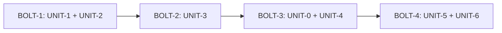

# Tasks — display-brightness-scheduler

## 2.9 Delivery plan
- **Verification command:** `test -z "$(gofmt -l .)" && go vet ./... && go test -race ./...`  (approved 2026-11-13 by human)
- Order follows the Unit DAG in design.md.
- Walking skeleton: UNIT-2 entrega `dusk list` lendo os monitores reais, o primeiro slice ponta a ponta (somente leitura).

Caption: três bolts em sequência; cada um termina com o comando de verificação verde.

### BOLT-1 — Units: UNIT-1, UNIT-2 — Owner: dono do PC + AI
- Goal: config, agenda pura e visão dos 3 monitores reais.
- DoD: verification command verde; `dusk list` mostra AOC, LG e Samsung.
- Confidence hypothesis: o `ddcutil detect --brief` é parseável de forma estável; risco: Samsung sem capabilities.

### BOLT-2 — Units: UNIT-3 — Owner: dono do PC + AI
- Goal: aplicar agenda e modo noturno com segurança e restauração.
- DoD: verification command verde. O teste manual supervisionado (RGB em monitor real e Night Light) passa para a UNIT-4, que traz o subcomando `run`; só com aprovação no momento.
- Risks: lentidão do DDC (≈1 s/chamada); monitores que ignoram ganho RGB.

### BOLT-3 — Units: UNIT-0, UNIT-4 — Owner: dono do PC + AI
- Goal: controle em runtime e autostart.
- DoD: verification command verde; instalação real do serviço só com sim explícito.

### BOLT-4 — Units: UNIT-5, UNIT-6 — Owner: dono do PC + AI
- Goal: configuração guiada e autostart.
- DoD: verification command verde; `dusk setup` real em modo somente leitura e instalação do serviço só com sim explícito.

## Tasks

### UNIT-1 Core: config e agenda   Status: verified (2026-11-13, exit 0)
- [x] T-1.1 `go mod init` e estrutura de pacotes `cmd/dusk`, `internal/...` — covers: NFR-7 — files: go.mod — test: `go build ./...`
- [x] T-1.2 Tipos de config e `Load` TOML com `BurntSushi/toml` — covers FR-13, US-3 AC3 — files: internal/config — test: config_test (válido)
- [x] T-1.3 Validação (horas, faixas, duplicados, `match`) com erros por campo — covers FR-13 — files: internal/config — test: tabela de inválidos
- [x] T-1.4 `schedule.Target` com interpolação linear circular — covers FR-5, US-3 AC1, NFR-8 — files: internal/schedule — test: tabela (20:00→30%, virada de meia-noite)
- [x] T-1.5 Intensidade noturna com rampas de entrada/saída — covers FR-7, US-4 AC1 — files: internal/schedule — test: 21:15→0,5; saída
- [x] T-1.6 Passos: função que limita a 1 ponto e dedupe de valor — covers FR-6, NFR-1 — files: internal/schedule — test: ≤20 escritas na rampa de 20 pontos
- [x] T-1.7 `justfile` com receitas default, build, test, fmt, fmt-check, vet, check (o comando aprovado, sem alterações), run — covers prática [user] "use justfile", NFR-7 — files: justfile — test: `just check` sai com 0

**Unit summary (Construction 3.5):** arquivos: go.mod, go.sum, justfile, .gitignore, cmd/dusk/main.go, internal/config/{config.go,config_test.go}, internal/schedule/{schedule.go,schedule_test.go}. Como rodar: `just check` (verificação oficial), `just build`, `just run check-config <arquivo>`. Resultado: `just check` exit 0 em 2026-11-13 (config e schedule ok, -race). Desvios: (1) `schedule.Target(mon, t)` não recebe `cfg`, pois não precisa dele; (2) adicionei o subcomando `dusk check-config` (valida o TOML, FR-13), fora da lista de tarefas mas dentro do escopo da Unit; (3) benchmark NFR-8.1 não foi criado (era informativo); (4) cmd/dusk sem testes automatizados, só smoke manual do exit code 1 em config inválida.

### UNIT-2 Monitores   Status: verified (2026-11-13, exit 0)
- [x] T-2.1 Parser de `ddcutil detect` com fixture real — covers FR-2 — files: internal/ddc — test: fixture dos 3 monitores
- [x] T-2.2 `Display` com `Get/Set`, whitelist VCP e clamp — covers NFR-2 — files: internal/ddc — test: Set(0x14) rejeitado; clamp
- [x] T-2.3 Runner de `ddcutil` injetável + fake em testes — covers NFR-2 — files: internal/ddc — test: nenhum teste executa ddcutil real
- [x] T-2.4 `Discover` e `Match` por modelo+serial — covers FR-4, US-2 AC3 — files: internal/monitors — test: troca de bus mantém match; LG sem serial
- [x] T-2.5 Subcomando `dusk list` (somente leitura) — covers FR-2, US-2 AC1 — files: cmd/dusk — test: saída com fake; execução manual real

**Unit summary (Construction 3.5):** arquivos: internal/ddc/{ddc.go,parse.go,exec.go,ddc_test.go,testdata/detect_brief.txt}, internal/ddc/ddctest/ddctest.go, internal/monitors/{monitors.go,monitors_test.go}, cmd/dusk/{main.go,main_test.go}. Como rodar: `just check`; `just run list` (somente leitura). Resultado: `just check` exit 0 em 2026-11-13; `dusk list` real mostrou AOC 24G4 (bus 5, 30/100), LG ULTRAWIDE (bus 7, 40/100) e Samsung LF24T450F (bus 8, 25/100), os três com RGB, em ~4,7 s. Cobertura: ddc 97,6%, monitors 100%. Desvios: (1) `Display` recebe `ctx` (A-15); (2) `match` usa o modelo do EDID, sem o fabricante (A-14); (3) capacidades por sondagem de leitura, não por `capabilities` (Samsung truncado); (4) `FakeDisplay` e `FakeRunner` em `internal/ddc/ddctest` para a UNIT-3; (5) `main.go` refatorado com `run(ctx, args, runner, stdout, stderr)` para testar. Observação: `list` leva ~4,7 s porque faz 13 chamadas ao ddcutil.

### UNIT-3 Controller   Status: verified (2026-11-13, exit 0)
- [x] T-3.1 Loop de tick com relógio injetável — covers FR-6 — files: internal/controller — test: tick avança passo a passo
- [x] T-3.2 Aplicação de brilho com passo ≤1 e intervalo ≥2 s — covers FR-6, FR-11, NFR-1 — files: internal/controller — test: mock registra escritas
- [x] T-3.3 Aplicação de ganho RGB noturno — covers FR-8, US-4 — files: internal/controller — test: azul abaixo do original
- [x] T-3.4 Persistência e restauração de RGB originais — covers FR-10, ADR-5 — files: internal/state — test: restart no meio da rampa restaura
- [x] T-3.5 Adaptador Night Light e fallback com A-8 — covers FR-9 — files: internal/nightlight — test: mock sem RGB liga
- [x] T-3.6 Redeteção periódica e backoff por falha — covers FR-3, NFR-4 — files: internal/controller — test: monitor que reaparece volta; falha isolada
- [x] T-3.7 Restauração no SIGTERM e logs estruturados — covers FR-10, NFR-5 — files: internal/controller — test: cancelamento do ctx restaura

**Unit summary (Construction 3.5):** arquivos: internal/state/{state.go,state_test.go}, internal/nightlight/{nightlight.go,nightlight_test.go}, internal/controller/{controller.go,controller_test.go}; ajustes em internal/schedule (NightLightKelvin), internal/ddc/exec.go (mensagem de erro genérica) e internal/ddc/ddctest (OnSet, SetFailure, SetValue, Value, SetAttempts). Resultado: `just check` exit 0 em 2026-11-13. Cobertura: controller 86,3%, nightlight 87,8%, state 64,3% (caminhos de erro de I/O), schedule 100%. Mutação: 6 mutações no controller (não salvar o original antes de escrever, sem espera, passo de 2, fallback sem reduzir DDC, ignorar backoff, shutdown sem restaurar) foram todas detectadas pelos testes. Desvios: (1) `NightLightKelvin` adicionado à UNIT-1 com aprovação do plano; (2) pico do fallback = temperatura atual do usuário (2700 K), não valor fixo; (3) sem subcomando `run`: o teste supervisionado em hardware/GNOME reais fica para a UNIT-4; (4) monitores sem serial e com o mesmo modelo colidem na chave (o segundo é ignorado com aviso). Nada foi escrito em monitores ou no gsettings reais.

### UNIT-0 Rename to dusk, English, auto backend   Status: verified (2026-11-13, exit 0)
- [x] T-0.1 Rename module, binary, paths, socket, service names and justfile to `dusk` — covers: ADR-9 — files: go.mod, cmd/dusk, justfile, internal/** — test: `just check`
- [x] T-0.2 Translate code, comments, errors, logs, CLI output and test names/messages to English — covers: NFR-10 — files: all .go — test: `just check` + `just english-check`
- [x] T-0.3 `night.fallback` accepts `auto`/`off` (replaces `gnome`) — covers FR-17 — files: internal/config, internal/controller — test: config and controller tests
- [x] T-0.4 `nightlight.Detect` picks the backend at runtime; none means fallback disabled with a warning — covers FR-17, NFR-9 — files: internal/nightlight — test: fake runner with and without gsettings
- [x] T-0.5 `just english-check` recipe and the English convention recorded in design 2.2 and project memory — covers NFR-10 — files: justfile — test: recipe exits 0

**Unit summary (Construction 3.5):** module, binary, cmd/dusk, justfile, config and state directories renamed to `dusk`; every `.go` file, the justfile and the fixtures are ASCII/English (code, comments, errors, logs, CLI output, test names and messages); `night.fallback` is now `auto`|`off` (the old `gnome` value is rejected); `nightlight.Detect` returns `ErrNoBackend` when GNOME night light is unavailable, and with no backend the controller logs one warning and keeps using DDC only; `just english-check` added (not part of the approved `just check`). Result: `just check` exit 0 and `just english-check` exit 0 on 2026-11-13. Deviations: (1) the `.aidlc` documents stay in pt-BR by design; (2) wiring `Detect` into a real `run` happens in UNIT-4; (3) the project folder is still named RENOMEAR_DEPOIS and is renamed to `dusk` at the end, as agreed.

### UNIT-4 IPC e CLI   Status: verified (2026-11-13, exit 0)
- [x] T-4.1 Servidor e cliente por socket unix 0600 — covers FR-12 — files: internal/ipc — test: round-trip em tmpdir
- [x] T-4.2 `pause`/`resume` no controller — covers FR-12, US-5 — files: internal/controller — test: sem escritas pausado; retoma no alvo certo
- [x] T-4.3 `status` e códigos de saída — covers FR-12 — files: cmd/dusk — test: saída e exit 2 sem daemon
- [x] T-4.4 `reload` com validação que mantém config antiga — covers FR-13, US-3 AC3 — files: internal/controller — test: TOML inválido mantém antiga

**Unit summary (Construction 3.5):** new packages internal/ipc (unix socket 0600, one JSON line each way, stale-socket recovery, duplicate-daemon refusal) and internal/daemon (wires config, controller and socket; handles status/pause/resume/reload/stop); controller gained Pause/Resume/Paused/Wake/Status (pause also interrupts a convergence in progress); cmd/dusk gained run, status, pause, resume, reload, stop with exit codes 0/1/2. Result: `just check` exit 0 and `just english-check` exit 0 on 2026-11-13, repeated 3x with -race on the concurrent packages. Mutations (tick ignores pause, reload skips SetConfig, socket mode 0644) were all caught. Deviations: (1) `dusk run` with a missing config prints a generic hint until the setup wizard exists (UNIT-5); (2) `stop` is an IPC command, not systemctl (A-21); (3) the supervised run on real hardware has NOT happened yet (A-23): no real write to monitors or gsettings has been made by any test.

### UNIT-5 Setup wizard   Status: verified (2026-11-13, exit 0)
- [x] T-5.1 `config.Marshal` writes commented TOML that `Parse` reads back — covers FR-15 — files: internal/config — test: round trip with defaults and custom values
- [x] T-5.2 `preflight`: ddcutil present, I2C access, night-light backend, with actionable hints — covers FR-16, NFR-9, US-6 AC2 — files: internal/preflight — test: fakes for each failure
- [x] T-5.3 `prompt` helpers (string with default, validated, yes/no, choice, list) — covers FR-15 — files: internal/prompt — test: scripted stdin, retry on invalid input, EOF handling
- [x] T-5.4 Wizard flow: discover, per-monitor nickname and schedule, night mode, fallback, preview, validate, backup, write — covers FR-15, US-6 AC1 — files: internal/setup — test: end-to-end scripted run with FakeRunner in a temp dir
- [x] T-5.5 Edge cases: 0 monitors, no serial, no RGB, same model twice, existing config as defaults — covers FR-16, US-6 AC3, US-7 AC1 — files: internal/setup — test: one case each
- [x] T-5.6 `dusk setup [--yes] [--config path]` wiring and exit codes — covers FR-15 — files: cmd/dusk — test: run() with fakes
- [x] T-5.7 Closing summary with next steps (`dusk run`, `dusk install`) — covers US-6 — files: internal/setup — test: output assertion

**Unit summary (Construction 3.5):** new packages internal/prompt, internal/preflight, internal/setup; config gained Marshal, ParseClock, FormatClock and FormatDuration (UNIT-1 package, approved in the plan); `dusk setup [--yes] [--config path]` added. The wizard checks ddcutil, /dev/i2c-*, i2c access and the night-light backend with exact hints, discovers monitors read-only, asks name and schedule per monitor, asks about night mode (validated as a whole), previews the TOML, backs up an existing file as <path>.bak-<timestamp> and writes atomically. Result: `just check` and `just english-check` exit 0 on 2026-11-13. Coverage: setup 87.7%, preflight 98.0%, prompt 92.6%, config 98.9%. Mutations (no backup, confirmation ignored, night window not validated, non-connected entries dropped) were all caught. A real read-only run (`dusk setup --yes --config <scratchpad>`) detected the 3 monitors and wrote a valid TOML to a scratch path; the real config directory was not touched and no write reached monitors or gsettings. Deviations: (1) `dusk run` with no config now points to `dusk setup`; (2) the README and the install hint in the final summary of the wizard are still pending (UNIT-6).

### UNIT-6 Instalação e systemd   Status: verified (2026-11-13, exit 0)
- [x] T-6.1 Gerador de unit `systemd --user` — covers FR-1, US-1 — files: internal/install — test: golden file
- [x] T-6.2 `install`/`uninstall`; sem config, oferece rodar `setup` — covers FR-14 — files: internal/install — test: HOME temporário
- [x] T-6.3 Checagem de acesso I2C e dependência `ddcutil` — covers NFR-6, A-3 — files: internal/install — test: mensagem de erro clara
- [x] T-6.4 README de uso (configuração, comandos, pausa) — covers FR-12 — files: README.md — test: revisão manual

**Unit summary (Construction 3.5):** new package internal/install (`RenderUnit`, `ResolveBin`, `Install`, `Uninstall`); commands `dusk install [--yes] [--no-start] [--config] [--bin]` and `dusk uninstall [--yes]`; `just install` / `just uninstall`; README.md (English); the setup wizard now suggests `dusk install` and can share its prompter with install. The service is a systemd user unit (`graphical-session.target`, `Restart=on-failure`); `install` refuses a temporary `go run` binary, offers the setup wizard when there is no config, shows the plan and asks for confirmation; `uninstall` keeps the config and state files. Result: `just check` and `just english-check` exit 0 on 2026-11-13; install coverage 84.1%; 3 mutations (install without confirmation, systemctl without --user, uninstall deleting the config) were all caught; the generated unit passes `systemd-analyze --user verify`. Deviations: (1) the README example uses a generic model, not the author's; (2) T-6.2 changed from generating an example TOML to offering the setup wizard; (3) the real `dusk install` was NOT run by the agent (A-29): the user runs it.

### FR-19 per-monitor night color level   Status: verified (2026-11-13, exit 0)
- [x] T-8.1 `config.MonitorNight`, `Monitor.NightFor`, parsing and validation of `night = { ... }`, `Marshal` support — covers FR-19 — files: internal/config — test: TestPerMonitorNightOverrides, TestPerMonitorNightInvalid, TestMarshalRoundTripWithMonitorNight
- [x] T-8.2 Controller uses the monitor's own gains — covers FR-19 — files: internal/controller — test: TestEachMonitorUsesItsOwnNightColorLevel, TestPerMonitorLevelAppliesToRedAndGreenToo, TestReloadedColorLevelTakesEffect
- [x] T-8.3 Setup asks per monitor and preserves existing overrides — covers FR-19, FR-15 — files: internal/setup — test: TestPerMonitorColorLevels, TestExistingColorLevelIsKeptAndCanBeRemoved, TestMonitorsWithoutColorControlAreNotAskedAboutColorLevels, TestNoColorLevelQuestionsWhenNightModeIsOff
- [x] T-8.4 README configuration reference updated — covers FR-19 — files: README.md
**Summary:** `just check` and `just english-check` exit 0 on 2026-11-13; 3 mutations (controller ignores the override, NightFor leaks into the ramp, Marshal drops the override) were caught. Existing configs keep working unchanged. No write reached monitors or gsettings; the user applies it with `dusk reload`.

