# Design — tui-software-color

## 2.1 Codebase analysis

Resumo do codekb em `.aidlc/codekb/DUSK/` (commit 4bfc430, Standard, human-reviewed). Go 1.26, ~4,3k linhas, uma dependência (BurntSushi/toml), daemon + CLI no mesmo binário.

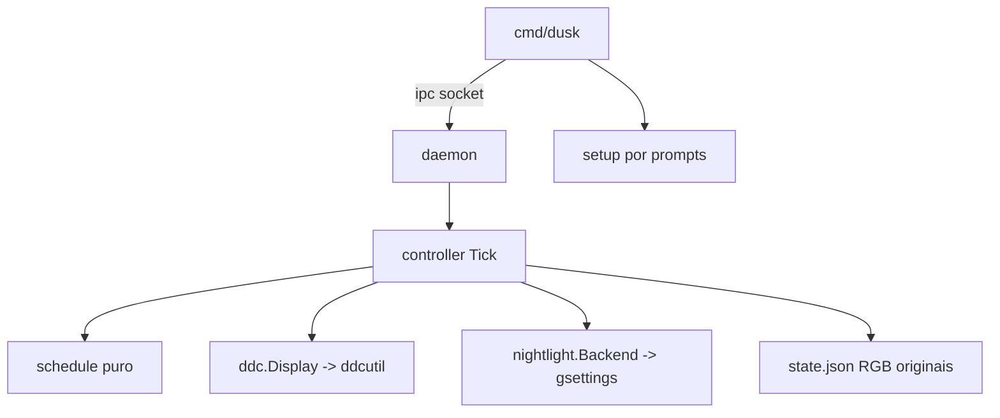
Caption: portas de hardware `ddc.Display` e `nightlight.Backend` são os pontos de troca; `schedule` é puro e reaproveitável.

- Baseline: `gofmt`, `go vet`, `go test -race ./...` verdes (2026-11-17).
- A aposentar [user]: fallback Night Light, `state.json` de RGB, `setup` por prompts, escritas DDC de RGB. Brilho 0x10 por DDC passa a opcional por monitor.
- Hot spots: controller.go (733 linhas), setup.go (629), main.go (501).
- Mapeamento DDC↔Mutter: `ddcutil` informa `card1-DP-1`; o Mutter nomeia a saída `DP-1` (casável por nome do conector).

### Assumptions & open questions
- Migração do `config.toml` existente para o novo modelo (a decidir em 2.3/2.8).
## 2.2 Team practices

Herdadas do intent anterior (261113) e conferidas no repositório; nada novo a promover para a memória (M-001..M-003 cobrem testes, DDC e idioma).

| Prática | Estado | Evidência |
|---|---|---|
| Linguagem / toolchain | Go 1.26, `go test -race` | go.mod, justfile |
| Verificação | `just check` = gofmt + vet + test -race; `just english-check` | justfile |
| Lint | `gofmt` e `go vet` apenas | justfile |
| Idioma do repo | inglês, ASCII; `.aidlc` em pt-BR | M-003 |
| Testes | nunca tocam hardware, adaptadores mockáveis | M-001 |
| Commits | Conventional Commits em inglês, só quando o usuário pede | CLAUDE.md global, git log |
| Branching/CI | só `main`, sem PR; **CI (GitHub Actions rodando `just check`) entra neste intent** [user, gate 2.2] | git branch; pedido do usuário |
| Cabeçalho de arquivo novo | Filename / Created on / Author | CLAUDE.md global |

### Assumptions & open questions
- A-2.2.1: sem golangci-lint; CI mínimo com `just check`. [user]
## 2.5 Refined mockups (TUI)

Navegação por abas no topo (escolha do usuário, gate 2.5): `1 Status · 2 Monitors · 3 Night · 4 Service`; `Tab`/`1-4` trocam; `?` ajuda; `q` sai; mínimo 80x24. Rótulos da UI em inglês (M-003).

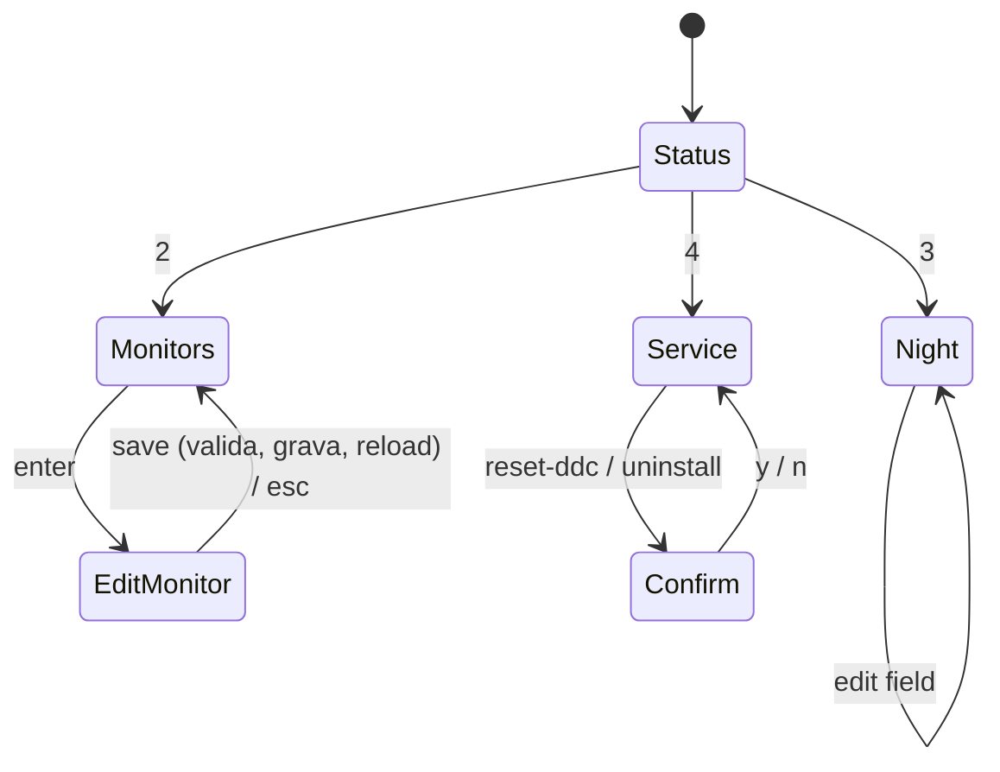
Caption: fluxo de telas; salvar sempre valida antes de gravar (FR-13).

**1 Status (US-4)**
```
┌ dusk ── ● running ── night 78% ── next change 07:00 ────────┐
 [1 Status] 2 Monitors  3 Night  4 Service

 Monitor   Brightness  Color now (R G B)   Target       Backend
 Direita   15% -> 15%  100  80  30         night 100 80 30  software
 Centro    20% -> 20%  100  80  30         night            ddc
 Samsung   18% -> 18%  100 100  45         night            software
 ! GNOME Night Light is on: dusk is re-applying colors
 p pause/resume   r reload   ? help   q quit
```
**2 Monitors (US-2, US-5)**: lista; `enter` abre o editor.
```
 Edit: Direita (AOC 24G4#12VP9...)      connector DP-1
 Brightness backend  [software|ddc]     Floor [10]%
 Night level   R [100]  G [ 80]  B [ 30]   (blank = inherit)
 Schedule
   08:00  30%      a add  d delete  e edit
   18:00  20%
   22:00  15%
 ctrl+s save   esc cancel     error: <field message>
```
**3 Night (US-6)**: `Enabled [x]  Start [19:00]  End [07:00]  Ramp [30m]  Default R/G/B`; barra de intensidade ao vivo.
**4 Service (US-3, US-7)**: Install · Start · Stop · Pause · Logs (rolagem) · Reset DDC (confirmação `y/n` por monitor, mostra valores atuais e destino).

### Assumptions & open questions
- Cores do tema seguem o terminal (sem tema próprio). [inferred]

## 2.6 Domain & components

**Modelo.** Um *Monitor* (config) é ligado a uma *Saída* do Mutter (cor: rampa de gama por CRTC) e, opcionalmente, a um *Display* DDC (só brilho 0x10 e `reset-ddc`). O controller calcula, por monitor, `RGB alvo` e `brilho alvo` com funções puras (`schedule`) e entrega a um *ColorBackend* (gama) e a um *BrightnessDriver* (`software` = escala da mesma rampa; `ddc` = VCP 0x10).

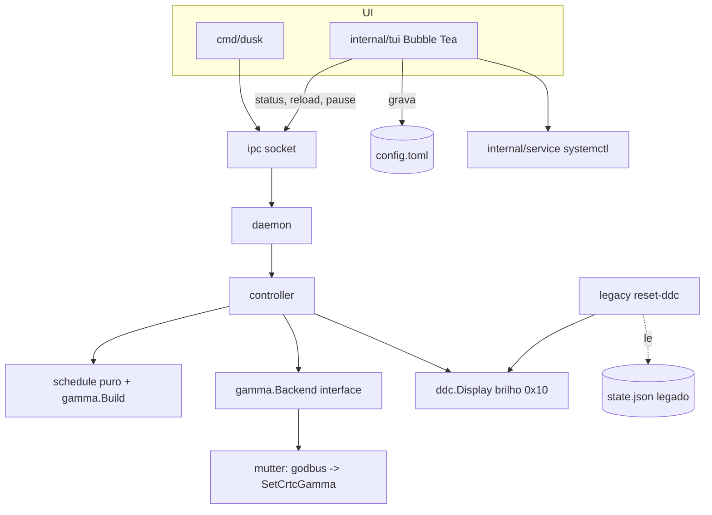
Caption: novos blocos `tui`, `service`, `gamma` (+`mutter`) e `legacy`; removidos `nightlight` e a escrita de `state.json`.

### Components (responsibility, interfaces, data ownership)

| Componente | Responsabilidade | Interface / dados |
|---|---|---|
| `internal/gamma` | `Ramp` (3×1024 uint16), `Identity()`, `Build(base, r, g, b, scale)` puro com clamp/monotonia; interface `Backend` (`Outputs`, `Get`, `Set`, `Watch`) | puro; sem I/O |
| `internal/gamma/mutter` | implementa `Backend` com godbus (`GetResources`, `Get/SetCrtcGamma`, sinal `MonitorsChanged`) | sessão D-Bus |
| `internal/gamma/gammatest` | fake em memória (M-001) | testes |
| `internal/controller` | para cada monitor: alvo de cor e brilho, aplica gama, escreve DDC 0x10 se backend `ddc`, detecta rampa alterada, restaura no `Shutdown` | `Options{Gamma, Discover, ...}` |
| `internal/config` | + `brightness` (`software`\|`ddc`), `floor`, `fallback` tolerado/ignorado; `Marshal` reaproveitado pela TUI | TOML |
| `internal/ddc`, `internal/monitors` | passam a opcionais; só 0x10 no caminho normal | mantidos |
| `internal/legacy` | `reset-ddc`: lê `state.json` antigo (somente leitura) e restaura 0x16/18/1A após confirmação | CLI + TUI |
| `internal/service` | extrai `install`/systemctl (start, stop, status, install, uninstall) para a TUI e a CLI | wrapper de `internal/install` |
| `internal/tui` | modelo Bubble Tea (abas), cliente IPC, editor de config; `Update` puro e testável | `ipc.Client`, `config` |
| `internal/ipc` | + status com ganhos aplicados e backend; (Could) `preview` | JSON/linha |
| removidos | `internal/nightlight`, `internal/setup`, `internal/prompt` (a TUI cobre); `state.go` fica só leitura legada | |

### Decisions

#### ADR-10 Cor e brilho por software via Mutter `SetCrtcGamma` — Status: accepted
- Context: DDC persiste no monitor (problema do intent); spike provou escrita/leitura por CRTC. [src: requirements § 1.3]
- Decision: rampa de gama por CRTC, uma por monitor; cor = ganho R/G/B; brilho software = escala comum às três; rampa final = identidade × ganho × escala.
- Alternatives: Night Light do GNOME (global, só temperatura); overlay (não existe em Wayland).
- Consequences: API não estável do Mutter (isolada em `gamma.Backend`); brilho por gama perde contraste. Related: FR-1, FR-2, R1, R4, R5.

#### ADR-11 godbus/dbus como cliente D-Bus — Status: accepted
- Context: sem processo por chamada, tipos corretos, sinal `MonitorsChanged` para hotplug/retomada.
- Decision: `github.com/godbus/dbus/v5` (Go puro, sem cgo) dentro de `gamma/mutter`; o resto do código vê só `gamma.Backend`.
- Alternatives: subprocesso `gdbus` (fork por chamada, argv de 3072 valores, parsing frágil). [user: escolha no gate 2.6]
- Consequences: segunda dependência Go. Related: FR-6, NFR-2, NFR-5.

#### ADR-12 Base é a rampa identidade e o `ExecStopPost` garante a restauração — Status: accepted
- Context: ler a rampa no início seria errado após um crash (resíduo escalado). Perfis ICC/`vcgt` estão fora de escopo.
- Decision: base = rampa linear; `Shutdown` e `dusk reset-gamma` aplicam identidade em todas as saídas; a unit systemd ganha `ExecStopPost=dusk reset-gamma` (cobre crash e kill).
- Alternatives: guardar rampa original em disco (volta ao problema de estado persistente).
- Consequences: calibração por ICC é sobrescrita enquanto o dusk roda; FR-4 passa a significar "volta à identidade". Related: FR-4, NFR-1, R2.

#### ADR-13 TUI grava `config.toml` e pede `reload` — Status: accepted
- Context: TOML segue editável à mão; socket sem valores é mais seguro. [user: gate 2.3]
- Decision: a TUI valida com `config.Parse`, grava atômico com backup `.bak-<timestamp>` e envia `reload`; sem daemon, a TUI mostra "stopped" e oferece Start. Prévia (FR-14, Could) via comando IPC `preview` com TTL, só se sobrar tempo.
- Alternatives: IPC `set-config`.
- Consequences: reaproveita `Marshal` e a validação; perde comentários escritos à mão ao salvar (o `Marshal` regenera os comentários padrão). Related: FR-10, FR-11, FR-13.

#### ADR-14 Bubble Tea + Bubbles + Lip Gloss — Status: accepted
- Context: precisa de `Update` testável sem terminal. [user: gate 2.6]
- Decision: modelo Elm; teste enviando `tea.Msg` e inspecionando `View()`; `ipc.Client` e escrita de config atrás de interfaces.
- Alternatives: tview, tcell cru.
- Consequences: dependências transitivas (x/term, termenv); binário maior. Related: FR-9..12, NFR-6.

#### ADR-15 DDC reduzido a brilho opcional e `reset-ddc` — Status: accepted
- Context: nada de RGB no hardware (M-002 revisada: 0x16/18/1A só em `reset-ddc` confirmado). [user: gate 2.1, 2.3]
- Decision: `controller` só chama `Set(VCPBrightness)`; `legacy.ResetDDC` é o único código que escreve 0x16/18/1A, sempre por ação explícita.
- Alternatives: manter RGB DDC como opção por monitor.
- Consequences: M-002 precisa ser atualizada (memória proposta no fim da Inception). Related: FR-3, FR-8, NFR-1.

#### ADR-16 Identidade do monitor vem do Mutter — Status: accepted
- Context: LG ULTRAWIDE tem serial `0x01010101` no Mutter e vazio no ddcutil; conector DRM `card1-DP-1` ↔ saída `DP-1`.
- Decision: chave = `product` (modelo) ou `product#serial` do Mutter com a mesma regra de `match` de hoje (serial só vale se a config tem `#`); o DDC é casado por conector; sem DDC o monitor funciona só por gama.
- Consequences: `match` existente continua valendo (FR-16). Related: FR-5, FR-16, R3.

### Assumptions & open questions
- A7: o nome do conector DDC (`card1-HDMI-A-1`) contém o nome da saída do Mutter como sufixo. **Refutada em parte (UNIT-1):** o Mutter chama o LG de `HDMI-1`; o casamento deve normalizar `HDMI-A-N` ↔ `HDMI-N` e, se falhar, cair para o casamento por modelo/serial. [user-verified no hardware]
- A8: a rampa de 1024 pontos é igual em todos os CRTCs (o tamanho é lido por CRTC, não fixo). [inferred]
- A9: reaplicação por sinal `MonitorsChanged` + verificação periódica cobre hotplug/retomada. [inferred]
## 2.7 Units of work

Fatias verticais em ordem de dependência. UNIT-1 é o *walking skeleton*: prova ponta a ponta o caminho D-Bus real (`dusk reset-gamma`).

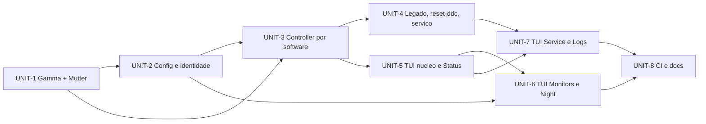
Caption: DAG acíclico; ordem topológica 1, 2, 3, {4, 5}, {6, 7}, 8 (4 e 5, 6 e 7 podem ser paralelas).

### UNIT-1 Gamma e backend Mutter (walking skeleton)
- Escopo: `internal/gamma` (Ramp, Identity, Build puro), `gamma/mutter` (godbus: Outputs, Get, Set, Watch), `gammatest` (fake), comando `dusk reset-gamma`.
- Entrega: rampa identidade aplicada de verdade em todas as saídas, testes sem D-Bus.
- Dá suporte a: FR-4, FR-6 (primitivas), NFR-4, NFR-5.

### UNIT-2 Config e identidade de monitor
- Escopo: `config` com `brightness`, `floor`, `fallback` ignorado com aviso; `monitors`: casar config ↔ saída Mutter ↔ Display DDC por conector (ADR-16); `Marshal` atualizado.
- Dono de: FR-5, FR-16, US-8.

### UNIT-3 Controller por software
- Escopo: controller usa `gamma.Backend`; cor + brilho software com piso; brilho DDC opcional (só 0x10, restaura original ao parar); reaplica quando a rampa muda (`Watch` + verificação); Shutdown restaura identidade; status estendido (ipc/daemon).
- Dono de: FR-1, FR-2, FR-3, FR-4, FR-6, FR-17, US-1, US-2.

### UNIT-4 Legado, reset-ddc e serviço
- Escopo: remover `nightlight`, `setup`, `prompt` e escrita de `state.json`; `legacy.ResetDDC` + `dusk reset-ddc` com confirmação; `internal/service`; unit systemd com `ExecStopPost=dusk reset-gamma`; `ddcutil` opcional no preflight.
- Dono de: FR-7, FR-8, US-3, US-9.

### UNIT-5 TUI núcleo e Status
- Escopo: `internal/tui` (Bubble Tea, abas, ajuda, cliente IPC, estado "daemon parado"), aba Status ao vivo; `dusk` sem args abre a TUI, `dusk setup` alias.
- Dono de: FR-9, FR-15, US-4.

### UNIT-6 TUI Monitors e Night
- Escopo: editor de monitores/agenda e do modo noturno; validação por campo; escrita atômica com backup e `reload`; (Could) prévia ao vivo.
- Dono de: FR-10, FR-11, FR-13, FR-14, US-5, US-6.

### UNIT-7 TUI Service e Logs
- Escopo: aba Service (install/uninstall/start/stop/pause), logs com rolagem, reset DDC com confirmação.
- Dono de: FR-12, US-7.

### UNIT-8 CI e documentação
- Escopo: GitHub Actions (`just check`, `just english-check`), README, atualização das memórias (M-002), limpeza final.
- Dono de: FR-18, FR-19, US-10.

### Dependency order
1 → 2 → 3 → {4, 5} → {6, 7} → 8.

### Story → Unit map

| Story | Unit | FRs |
|---|---|---|
| US-1 | UNIT-3 | FR-1, FR-2, FR-4, FR-6, FR-17 |
| US-2 | UNIT-3 | FR-3 |
| US-3 | UNIT-4 | FR-8 |
| US-4 | UNIT-5 | FR-9 |
| US-5 | UNIT-6 | FR-10, FR-13, FR-14 |
| US-6 | UNIT-6 | FR-11 |
| US-7 | UNIT-7 | FR-12 |
| US-8 | UNIT-2 | FR-16 (FR-15 em UNIT-5) |
| US-9 | UNIT-4 | FR-5 (UNIT-2), FR-7, FR-19 (UNIT-8) |
| US-10 | UNIT-8 | FR-18 |

### Assumptions & open questions
- A10: UNIT-1 não tem história própria (habilitadora); NFR-4/NFR-5 cobrem sua verificação. [inferred]
- A11: FR-14 (prévia) é Could e só entra na UNIT-6 se sobrar tempo. [inferred]
## 2.8 Contracts

### config.toml (evolução compatível, FR-16)

```toml
poll_interval   = "30s"
rescan_interval = "30m"
verify_interval = "1m"   # com gama a releitura é barata; padrão cai de 5m para 1m

[night]
enabled = true
start = "19:00"
end = "07:00"
ramp = "30m"
blue_gain = 30
red_gain = 100
green_gain = 100
# fallback = "auto"   # aceito e ignorado com aviso (legado)

[[monitor]]
name = "Direita"
match = "24G4#12VP9XA002026"   # "model" ou "model#serial"
brightness = "software"        # NOVO: "software" (padrão) | "ddc"
floor = 10                     # NOVO: piso 0-50 (%), só software
night = { blue_gain = 30, red_gain = 100, green_gain = 80 }
points = [ { time = "08:00", brightness = 30 } ]
```
Regras: chave desconhecida continua sendo erro, exceto `fallback`; `brightness` inválido, `floor` fora de 0-50 → `ValidationError` com o caminho do campo (a TUI mostra no campo).

### Interface de cor (Go, ADR-10/11)

```go
package gamma

const RampSize = 1024 // lido por CRTC; este é o valor típico

type Ramp struct{ R, G, B []uint16 }

type Output struct {
    CRTC      uint32
    Name      string // "DP-1", "HDMI-A-1"
    Vendor    string
    Product   string // modelo, casa com "match"
    Serial    string
}

type Backend interface {
    Outputs(ctx context.Context) ([]Output, error)
    Get(ctx context.Context, o Output) (Ramp, error)
    Set(ctx context.Context, o Output, r Ramp) error
    // Watch envia em ch quando monitores mudam (hotplug, retomada).
    Watch(ctx context.Context, ch chan<- struct{}) error
}

// Funções puras
func Identity(n int) Ramp
func Build(n int, r, g, b, scale float64) Ramp // r,g,b e scale em [0,1]; clamp e monotonia
func BrightnessScale(percent, floor int) float64 // floor + (100-floor)*percent/100, em [0,1]
```
Erros: `ErrNoBackend` (sem Mutter), `ErrOutputGone`; falha de D-Bus → monitor `Online=false` com backoff (NFR-4).

### Brilho

`BrightnessDriver`: `software` = `scale` na rampa; `ddc` = `ddc.Display.Set(VCPBrightness, v)`. Em `ddc`, o brilho original lido no start é restaurado ao parar (A4). Nenhum outro VCP no caminho normal (NFR-1).

### IPC (socket unix, JSON por linha; contrato anterior mantido)

| Comando | Campos | Resposta |
|---|---|---|
| `status`, `pause`, `resume`, `reload`, `stop` | `cmd` | como hoje |
| `preview` (Could, FR-14) | `cmd`, `monitor`, `r`,`g`,`b`, `brightness`, `ttl_s` ≤ 30 | `ok` ou `error`; expira sozinho, nunca grava |

`MonitorStatus` ganha: `brightness_backend`, `floor`, `gamma` `{r,g,b}` (ganho aplicado em %), `scale` (%), `output` (nome do conector), `ddc` (bool). Campos `rgb*` de DDC saem; `fallback_*` saem de `NightStatus`; `warnings []string` (ex.: "GNOME Night Light is on") entra em `Status`.

### CLI

`dusk` (sem args, TTY) → TUI · `run`, `status`, `pause`, `resume`, `start`, `stop`, `reload`, `logs`, `install`, `uninstall`, `check-config`, `list` (agora lista saídas Mutter e DDC) · **novos:** `reset-gamma` (identidade em todas as saídas, sem confirmação, idempotente), `reset-ddc` (confirmação por monitor; escreve 0x16/18/1A) · `setup` = alias da TUI.

### systemd unit

`ExecStopPost=<bin> reset-gamma` (ADR-12); `Restart=on-failure` mantido. `dusk install` regrava a unit.

### Arquivos

`state.json` legado: leitura apenas (por `reset-ddc`); o dusk não grava mais. `config.toml`: gravado pela TUI de forma atômica (arquivo temporário + rename) com backup `config.toml.bak-<timestamp>`.

### Assumptions & open questions
- A12: `verify_interval` padrão 1m para gama; configs existentes com `5m` continuam válidas. [inferred]
- A13: `floor` limitado a 0-50 evita configuração que escureça demais; 0 permite preto total por escolha explícita. [inferred]

## 3.1–3.3 UNIT-1 — Gamma e backend Mutter (design funcional, NFR e mecanismos)

Escopo: `internal/gamma` (puro), `internal/gamma/gammatest` (fake), `internal/gamma/mutter` (godbus), comando `dusk reset-gamma`. 3.4 não se aplica (sem infraestrutura; o `ExecStopPost` é da UNIT-4). Testes jamais tocam D-Bus real (M-001).

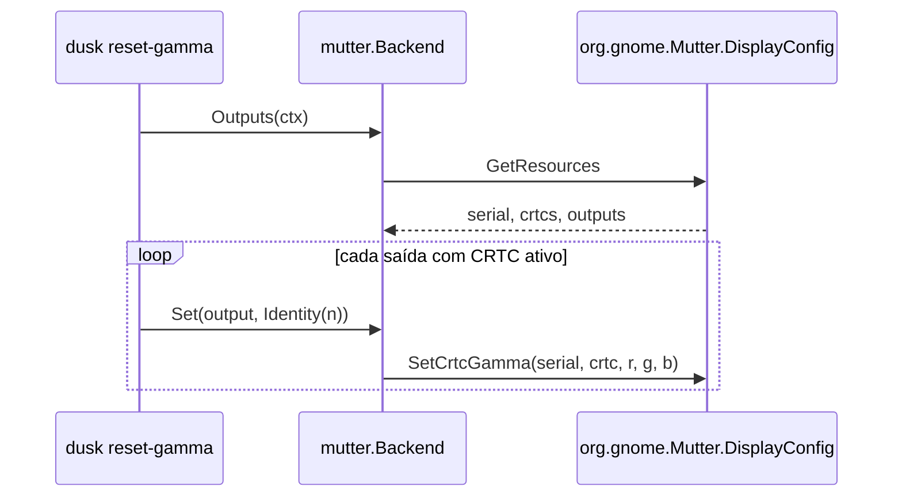
Caption: `reset-gamma` ponta a ponta (walking skeleton).

### Entidades e regras

| Tipo | Regra |
|---|---|
| `Ramp{R,G,B []uint16}` | os três canais têm o mesmo tamanho n ≥ 2; `Valid()` checa tamanho e monotonia não decrescente |
| `Identity(n)` | `v[i] = round(i * 65535 / (n-1))` |
| `Build(n, r, g, b, scale)` | `v[i] = round(Identity[i] * ganho * scale)`, ganhos e scale clampados em [0,1]; monotonia garantida pela construção |
| `BrightnessScale(p, floor)` | `(floor + (100-floor)*p/100) / 100`, p e floor clampados em [0,100] |
| `mutter.Backend.Outputs` | uma `Output` por saída do Mutter **com CRTC ativo** (`current_crtc >= 0`); `Name`, `Vendor`, `Product`, `Serial` das propriedades; serial `0x01010101` e vazio tratados como sem serial |
| `Get/Set` | o `serial` da configuração é relido a cada `Outputs`; `Set` com serial vencido (`ErrStale`) refaz `GetResources` uma vez e repete |
| `Set` | recusa rampa inválida (`ErrInvalidRamp`) antes de chamar o D-Bus; o tamanho deve ser o do CRTC |
| `Watch` | assina `MonitorsChanged`; envia ao canal sem bloquear (buffer 1, coalescendo) |

### Erros e limites
Serviço ausente/sem sessão → `ErrNoBackend` com o motivo; CRTC sumiu → `ErrOutputGone`; qualquer erro D-Bus embrulhado com a operação. `dusk reset-gamma`: sem backend sai com código 1 e mensagem; idempotente; cada saída que falha não impede as outras.

### NFR da Unit
- NFR-4: rampa inválida nunca é enviada (teste); falha D-Bus não derruba o processo.
- NFR-5: o código D-Bus fica atrás de `mutter.Conn` (interface de 2 métodos: `Call`, `Signals`); testes usam fake.
- NFR-7: ausência do Mutter vira `ErrNoBackend` legível.
- NFR-8: arquivos novos com cabeçalho; ASCII; inglês.

### Mecanismos
`Conn` real = godbus `*dbus.Conn` (session bus) com `Object("org.gnome.Mutter.DisplayConfig", "/org/gnome/Mutter/DisplayConfig")`; timeout de 5 s por chamada via contexto.

### Assumptions & open questions
- A15: o tamanho da rampa de cada CRTC é lido com `GetCrtcGamma` na primeira vez e guardado; `Build` usa esse tamanho. [inferred]

## 3.1–3.3 UNIT-2 — Config e identidade de monitor (design funcional, NFR e mecanismos)

Escopo: `internal/config` (campos `brightness`, `floor`; `Marshal`), `internal/monitors` (`Resolve`: config ↔ saída Mutter ↔ Display DDC), `dusk list` com seção de telas por software. Sem infraestrutura (3.4 N/A). O controller atual continua usando `Match`/`Fallback` até a UNIT-3/4 (build verde a cada Unit).

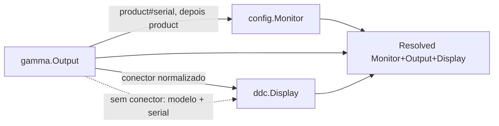
Caption: a saída do Mutter é a âncora; config e DDC se penduram nela.

### Regras

| Regra | Detalhe |
|---|---|
| Campos novos | `brightness` ∈ {`software` (padrão), `ddc`}; `floor` inteiro 0–50 (padrão 10). Erros com caminho do campo, ex.: `monitor "Direita".floor: 80 is outside 0-50` |
| `floor` com `brightness = "ddc"` | aceito e ignorado (sem erro) |
| Marshal | emite `brightness`/`floor` só quando diferem do padrão; round-trip `Parse(Marshal(c)) == c` |
| `fallback` | continua aceito e funcional até a UNIT-4 (o aviso de "ignorado" nasce quando o `nightlight` for removido) |
| Casamento config↔saída | igual ao atual: `product#serial` (se a saída tem serial) vence `product`; sem diferenciar maiúsculas |
| Normalização de conector | tira o prefixo `cardN-` e converte `HDMI-A-N` → `HDMI-N`; compara sem diferenciar maiúsculas com `Output.Name` |
| Casamento saída↔DDC | 1º por conector normalizado; 2º, se nenhum conector casar, por modelo igual e serial igual ou vazio de um dos lados, apenas se único |
| Sem DDC | `Resolved.Display == nil`; o monitor segue controlável por gama |
| Saída sem entrada na config | `Resolved.Monitor == nil` (sem agenda), listada no `list` |

### NFR da Unit
NFR-5: `Resolve` é função pura (testes sem hardware). NFR-8: cabeçalho nos arquivos novos, ASCII. FR-16: o `config.toml` de 2026-11-13 continua válido (teste com o arquivo real do usuário copiado para `testdata`).

### Assumptions & open questions
- A16: `dusk list` não falha quando não há DDC; falha só se nem Mutter nem DDC enxergam monitores. [inferred]

## 3.1–3.3 UNIT-3 — Controller por software (design funcional, NFR e mecanismos)

Escopo: reescrita de `internal/controller` (cor e brilho por gama; brilho DDC opcional só 0x10), ajuste de `internal/daemon`, `internal/ipc` (status) e `printStatus`. 3.4 N/A. **Decisão de escopo:** o controller deixa de usar `nightlight` e `state` já nesta Unit (não faz sentido manter a lógica de fallback/RGB DDC só para removê-la depois); os pacotes `nightlight`, `setup`, `prompt` e a escrita de `state.json` são apagados na UNIT-4. O build continua verde porque nada mais os importa além de `setup`/`main`.

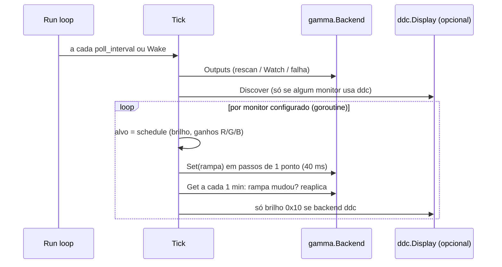
Caption: laço do controller; zero chamadas `ddcutil` quando nenhum monitor usa backend `ddc` (NFR-2).

### Regras

| Regra | Detalhe |
|---|---|
| Alvo de cor | `NightGains(monitor.NightFor(night), intensidade)` em % por canal (o mesmo cálculo de hoje, sem fator de fallback) |
| Alvo de brilho software | `BrightnessScale(Target(agenda), floor)`; rampa = `Build(n, r, g, b, escala)` |
| Brilho `ddc` | rampa só com cor (escala 1); brilho por `Set(VCPBrightness)` em passos de 1 com `MinWriteInterval`; leitura a cada `verify_interval`; original lido no 1º acesso e restaurado no Shutdown (A4) |
| Suavidade | estado atual `cur` (brilho %, ganhos %) → alvo em passos de 1 ponto com 40 ms entre passos; a interpolação por horário já é contínua, então em regime só há 0–1 passo por tick |
| Reaplicação | `Get` a cada 1 min (constante `gammaVerifyInterval`), em `Watch`, após rescan e no Resume; se a rampa difere da última aplicada, reaplica e conta; ≥ 3 divergências em 10 min geram o aviso "another program is changing the screen colors (is GNOME Night Light on?)" |
| Pause | `Pause` leva a rampa de todos os monitores à identidade (uma vez) e congela; `Resume` reaplica tudo imediatamente |
| Shutdown | identidade em todos os monitores tocados; brilho DDC original restaurado; contexto próprio de 15 s |
| Falhas | erro de gama/DDC → `fail` com backoff (5 s … 5 min), `Online=false` após 3 falhas; sem Mutter no start → laço segue tentando a cada rescan, status mostra o erro |
| Monitor sem entrada na config | ignorado (rampa intocada) |
| Rescan | `gamma.Outputs` a cada `rescan_interval`, ou 1 min se algo está offline, ou quando `Watch` dispara |

### Contrato de status (ipc, contrato 2.8)

`MonitorStatus`: `name`, `key`, `output`, `bus` (0 sem DDC), `ddc` (bool), `brightness_backend`, `floor`, `current`/`target` (brilho %), `gamma` {r,g,b} aplicados em %, `scale` %, `online`, `fails`, `last_error`, `night_level` {r,g,b}, `own_level`, `schedule`. `NightStatus` perde `fallback*`. `Status` ganha `warnings []string`. `rgb`, `rgb_target`, `rgb_original`, `color_control` saem.

### NFR da Unit
- NFR-1: o controller só chama `Set(VCPBrightness)` (teste com `FakeDisplay.Writes()` ≡ só 0x10).
- NFR-2: teste de contagem: 0 chamadas ao `Runner`/`Discover` com backend software; ≤ 1 `Get` de gama por monitor por minuto em regime.
- NFR-3: teste: saltos de rampa ≤ 1 ponto por passo.
- NFR-4: falha injetada em `Set`/`Outputs` não derruba o laço; rampa inválida nunca chega ao backend (validada em `gamma`).
- NFR-5: tudo por interfaces (`gamma.Backend`, `ddc.Display`), `Now`/`Sleep` injetados.

### Assumptions & open questions
- A17: `verify_interval` continua só para DDC; a verificação de gama usa a constante de 1 min (o contrato 2.8 previa mudar o padrão; não é necessário). [inferred]
- A18: pausar leva a tela à identidade (FR-4) e não restaura o brilho DDC. [inferred]

## 3.1–3.3 UNIT-4 — Legado, reset-ddc e serviço (design funcional, NFR e mecanismos)

Escopo: remover `internal/nightlight` e o campo `Night.Fallback`; `internal/legacy` + `dusk reset-ddc`; `internal/service`; `ExecStopPost=reset-gamma` na unit; aviso de `fallback` ignorado. 3.4 N/A (a unit systemd é parte do produto e é coberta por teste golden). **Desvio de plano:** a remoção de `internal/setup` e `internal/prompt` passa para a UNIT-5, onde `dusk setup` vira alias da TUI; remover o assistente agora deixaria quem não tem config sem caminho para criá-la. O assistente continua funcionando (só perde a pergunta sobre o fallback).

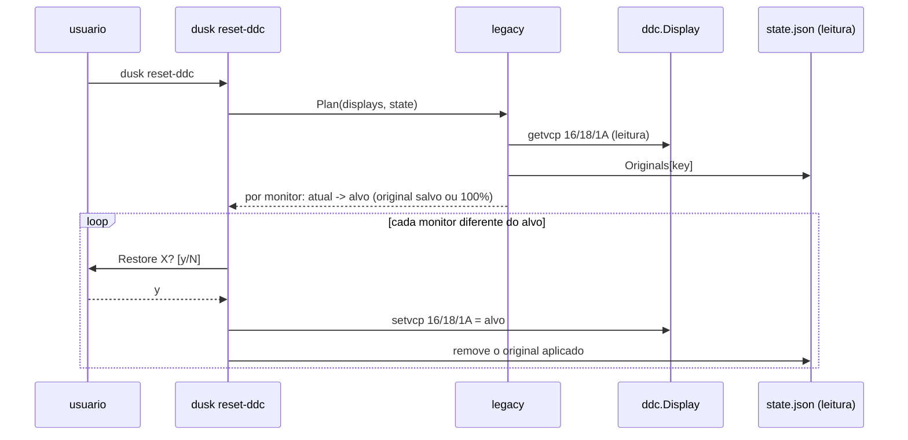
Caption: único caminho do dusk que escreve ganhos RGB por DDC (ADR-15).

### Regras

| Regra | Detalhe |
|---|---|
| `legacy.Plan` | lê 0x16/0x18/0x1A de cada display com `Caps.RGB`; alvo = `state.Originals[key]` se existir; sem original, o monitor só é listado (não se escreve) a menos que `--to-max` peça o máximo de cada canal; monitor já no alvo é pulado |
| Confirmação | uma por monitor (`y` aplica, qualquer outra coisa pula); `--yes` aplica todos; sem terminal e sem `--yes` → não escreve nada e explica |
| Aplicação | só 0x16/0x18/0x1A, com clamp ao máximo do monitor; ao terminar um monitor com sucesso remove o seu original de `state.json` |
| Falha | erro em um monitor é mostrado e não impede os outros; código de saída 1 se algum falhou |
| `fallback` no TOML | aceito com qualquer valor e ignorado; `Config.Warnings` ganha "night.fallback is ignored: night light is no longer used"; `check-config` e o status mostram os avisos |
| `internal/service` | `Manager{Systemctl, UnitPath}` com `State` (instalado/ativo), `Start`, `Stop`, para a CLI e a TUI; `dusk start` passa a usá-lo |
| Unit | `ExecStopPost=<bin> reset-gamma` (ADR-12) entre `ExecStart` e `Restart`; `dusk install` regrava a unit |
| `internal/state` | só leitura (`Load`) e remoção de entrada pelo `legacy`; o controller não grava mais |

### NFR da Unit
- NFR-1: teste com display falso: sem confirmação 0 escritas; com confirmação só 0x16/0x18/0x1A; nenhum outro VCP.
- NFR-5: tudo por `ddc.Display` e runner falsos; nenhum teste toca hardware (M-001).
- NFR-8: arquivos novos com cabeçalho, ASCII, inglês.

### Assumptions & open questions
- A19 (revista na implementação): sem original salvo **não** se assume 100%: no seu hardware os 3 monitores estão em 50/50/50, que é provavelmente o ajuste normal (o dusk antigo restaurava o original). `reset-ddc` só restaura o que há em `state.json`; sem original ele apenas informa e deixa o monitor, salvo `--to-max` explícito. [user-verified no hardware]

## 3.1–3.3 UNIT-5 — TUI núcleo e Status (design funcional, NFR e mecanismos)

Escopo: novo `internal/tui` (Bubble Tea v1 + Lip Gloss; ADR-14), abas, ajuda, cliente IPC, aba Status ao vivo, `dusk` sem argumentos num terminal abre a TUI. As abas Monitors, Night e Service existem na barra, com um texto "coming in the next step" até as UNIT-6 e UNIT-7. 3.4 N/A. **Desvio de plano:** `dusk setup` como alias da TUI e a remoção de `internal/setup` passam para a UNIT-6, porque só lá a TUI consegue criar a configuração do zero (`internal/prompt` fica: o `install` ainda o usa).

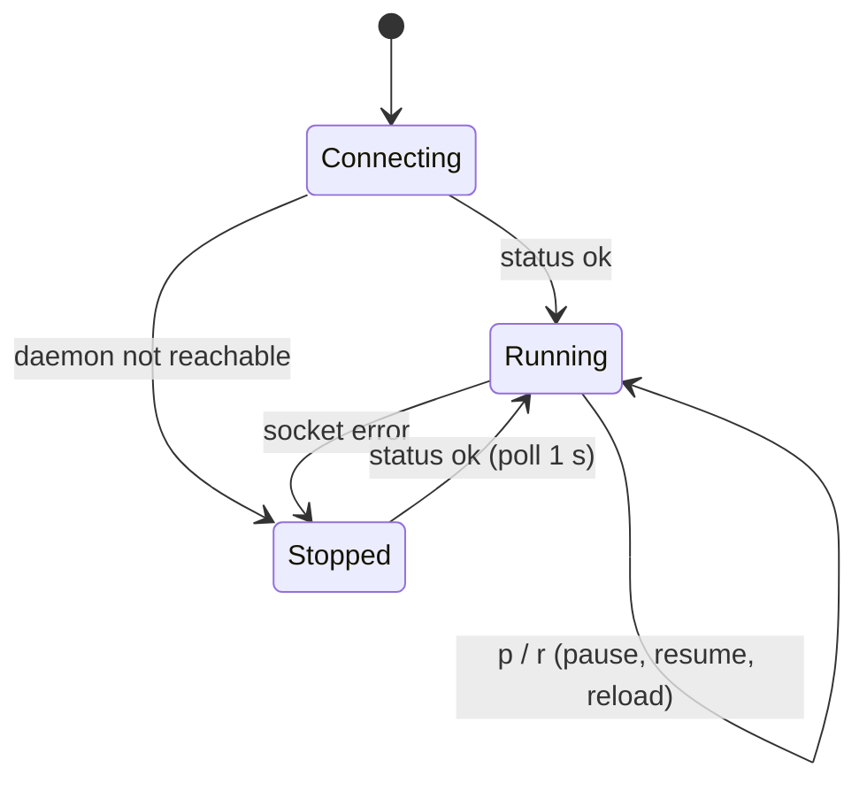
Caption: estados da conexão com o daemon; a TUI consulta o status a cada 1 s e nunca fecha sozinha quando o daemon cai.

### Regras

| Regra | Detalhe |
|---|---|
| Modelo | `tui.Model` implementa `tea.Model`; todo I/O vem por `tea.Cmd`; `Update` é puro dado o `Client` falso |
| Cliente | `tui.Client{Status(ctx) (*ipc.Status, error); Do(ctx, cmd string) error}`; `IPCClient` usa `ipc.Send` com timeout de 2 s |
| Atualização | `tickMsg` a cada 1 s dispara a consulta; respostas fora de ordem são descartadas por número de sequência |
| Cabeçalho | `dusk  ● running\|paused\|stopped   night 78% (fading in)   next 07:00` |
| Aba Status | tabela por monitor: nome, tela, brilho atual→alvo (+ backend), cor atual R G B, estado; avisos (`Warnings`) e último erro abaixo; sem daemon: "dusk is not running" + dica `dusk start` |
| Teclas | `1`-`4`, `Tab`/`Shift+Tab` trocam a aba; `p` pausa/retoma; `r` recarrega a config; `?` ajuda; `q`/`Ctrl+C` sai |
| Tamanho | mínimo 80x24; abaixo disso mostra "terminal too small (need 80x24)"; linhas longas são truncadas com `…` |
| Saída | restaura o terminal ao sair (alt screen do Bubble Tea) |
| Roteamento | `dusk` sem argumentos com stdin e stdout em terminal abre a TUI; sem terminal imprime o usage como hoje |

### NFR da Unit
- NFR-6: teste de `View()` em 80x24 sem estourar a largura; resposta a tecla é só `Update` (< 1 ms, sem I/O); o terminal é restaurado pelo Bubble Tea.
- NFR-5: nenhum teste usa terminal nem daemon reais (cliente falso).
- NFR-8: arquivos novos com cabeçalho, ASCII, rótulos em inglês.

### Assumptions & open questions
- A20: Bubble Tea v1.3.x, Lip Gloss v1.1.x (API estável); a v2 fica de fora por ser mais nova. [inferred]
- A21: o tema segue as cores do terminal (cores ANSI básicas, sem tema próprio). [inferred]

## 3.1–3.3 UNIT-6 — TUI Monitors e Night (design funcional, NFR e mecanismos)

Escopo: abas Monitors (lista + editor de monitor e agenda) e Night (modo noturno global), criação da configuração do zero, gravação segura do `config.toml` + `reload`, e a remoção de `internal/setup` com `dusk setup` virando alias da TUI. 3.4 N/A. A prévia ao vivo (FR-14, Could) fica de fora desta Unit se você concordar (T-6.6 vira backlog).

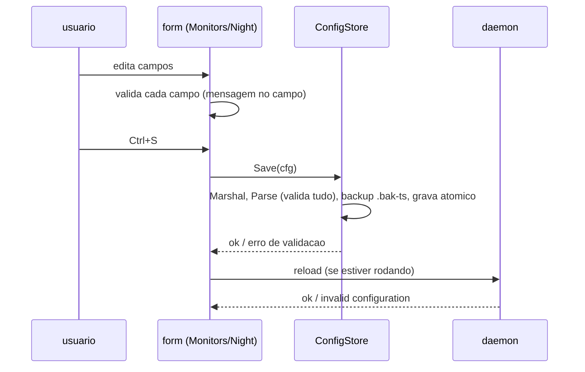
Caption: nada inválido chega ao disco; o daemon só recarrega arquivo que já passou por `config.Parse`.

### Regras

| Regra | Detalhe |
|---|---|
| `config.Write(path, cfg, now)` | `Marshal` → `Parse` (tem de passar) → copia o arquivo atual para `<path>.bak-<AAAAMMDD-HHMMSS>` → grava em arquivo temporário e `rename` (atômico) |
| `tui.ConfigStore` | `Path()`, `Load() (*config.Config, error)` (arquivo ausente → `os.ErrNotExist`), `Save(*config.Config) error` (usa `config.Write`) |
| `tui.ScreenSource` | `Screens(ctx) ([]gamma.Output, error)` (backend Mutter); falha vira aviso, não erro fatal |
| Config ausente | aba Monitors mostra "No configuration yet" e `n` cria uma padrão: uma entrada por tela detectada (nome = modelo, agenda 08:00 70% · 18:00 50% · 22:00 30%, brilho software, piso 10) e noite 21:00–07:00, rampa 30m, azul 60% |
| Aba Monitors | lista com cursor (`↑↓`/`j k`), `Enter` edita, `a` adiciona (pré-preenchida com a 1ª tela ainda sem entrada), `d` remove (pede `y`) |
| Editor de monitor | campos: Name, Match, Brightness (`software`/`ddc`, troca com `←→` ou espaço), Floor (0–50), Night R, G, B (vazio = herda), e a lista de pontos da agenda (`a` adiciona, `d` remove, `Enter` edita hora e brilho) |
| Aba Night | campos: Enabled, Start, End, Ramp, Red/Green/Blue (padrão global); mesma mecânica de formulário |
| Formulário | `Tab`/`Shift+Tab` ou `↑↓` movem o foco, `Ctrl+S` salva, `Esc` cancela (pergunta se há mudanças); edição de texto simples (digitar, Backspace); cada campo mostra seu erro logo abaixo |
| Validação por campo | hora `HH:MM`; duração `Go` (`30m`); percentuais 0–100; piso 0–50; nome não vazio e único; match não vazio e único; ≥ 1 ponto; horas da agenda sem repetição; erros cruzados vêm do `config.Parse` e aparecem numa linha de erro do formulário |
| Depois de salvar | envia `reload`; sem daemon mostra "saved; the daemon is not running" |
| `dusk setup` | abre a TUI (alias); `internal/setup` e o preflight DDC saem; `dusk install` sem config explica que a config se cria na TUI |
| Comentários do TOML | regravar regenera os comentários padrão (ADR-13); o backup `.bak` guarda o original |

### NFR da Unit
- NFR-5: `ConfigStore`, `ScreenSource` e `Client` falsos; testes de formulário só com `tea.Msg`; gravação testada em diretório temporário.
- NFR-6: tudo cabe em 80x24 (editor rola a agenda com 6 linhas visíveis); `Esc` sempre sai do modo de edição.
- NFR-1: a TUI nunca escreve em monitores; só em `config.toml` (e backup).
- NFR-8: cabeçalhos, ASCII, inglês.

### Assumptions & open questions
- A22: edição de texto própria (sem `bubbles/textinput`) basta para campos curtos (hora, número, nome); evita uma dependência a mais. [inferred]
- A23: a agenda padrão da criação do zero é 08:00 70% · 18:00 50% · 22:00 30%, os mesmos pontos do preset do assistente antigo. [inferred]

## 3.1–3.3 UNIT-7 — TUI Service e Logs (design funcional, NFR e mecanismos)

Escopo: aba Service (estado do serviço, instalar, desinstalar, iniciar, parar), visualizador de logs com rolagem, e o **reset DDC** com confirmação por monitor (FR-8 na TUI). Pausar/retomar continua na tecla global `p`. 3.4 N/A.

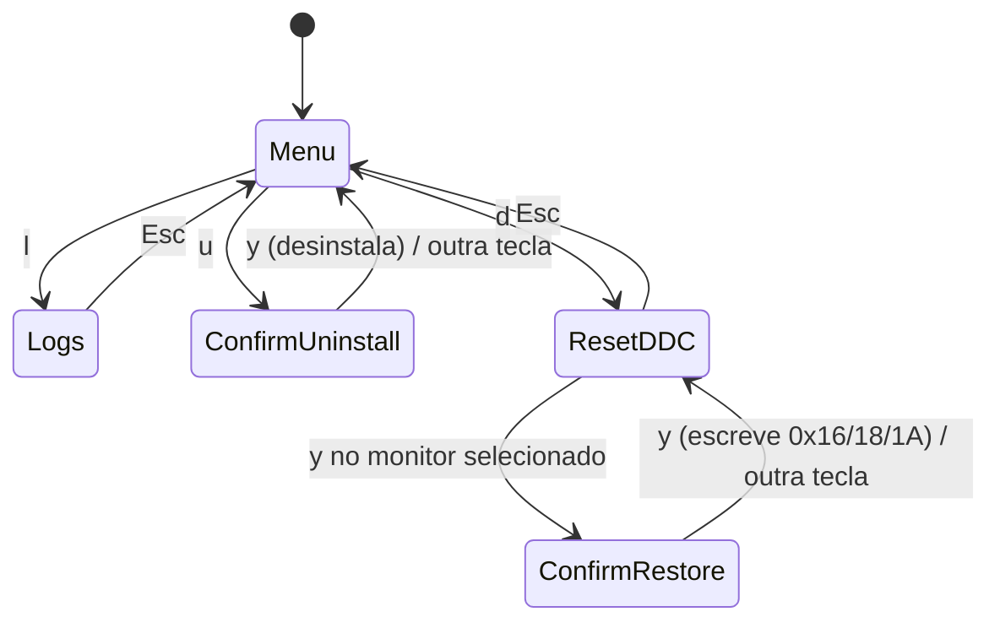
Caption: a TUI só escreve nos monitores dentro de `ConfirmRestore`, e só para o monitor mostrado.

### Regras

| Regra | Detalhe |
|---|---|
| Interface `tui.Service` | `State(ctx)`, `Start`, `Stop`, `Install` e `Uninstall` (devolvem o texto do que foi feito), `Logs(ctx, n)` (últimas n linhas); implementada em `cmd/dusk` com `service`, `install`, `logs` e as mesmas sementes (`systemctl`, `executable`, `journalctl`) da CLI |
| Interface `tui.DDCReset` | `Plan(ctx, toMax)` devolve itens (monitor, RGB atual, alvo, se há original salvo) sem escrever; `Apply(ctx, key, toMax)` restaura um monitor e esquece o original |
| Estado do serviço | atualizado ao abrir a aba, depois de cada ação e a cada 5 s com a aba aberta |
| Instalar | usa as opções da CLI com confirmação já dada (a tela explica o que será feito: unit em `~/.config/systemd/user`, `systemctl --user enable --now`); exige que exista config (senão orienta a criar na aba Monitors) |
| Desinstalar | pede `y`; mantém config e state |
| Iniciar/Parar | `s` inicia, `x` para (o daemon restaura as telas ao sair); resultado na linha de aviso |
| Logs | `l` abre as últimas 200 linhas; `↑↓`, `PgUp/PgDn`, `Home/End` rolam; `r` recarrega; `Esc` volta |
| Reset DDC | `d` lista os monitores com controle de cor DDC (leitura somente); `↑↓` escolhe; `y` pede a confirmação final mostrando "atual → alvo"; sem original salvo o item aparece como "no saved original" e só é aplicável depois de `m` (alvo = máximo 100%), nunca por padrão |
| Segurança | nenhuma escrita sem a confirmação `y` do item mostrado; cancelar com qualquer outra tecla |

### NFR da Unit
- NFR-1: teste: sem `y` não há escrita; só 0x16/0x18/0x1A (fake `DDCReset`/display).
- NFR-5: serviço, logs e reset por interfaces falsas; sem systemd, journald ou ddcutil nos testes.
- NFR-6: 80x24; logs truncam linhas largas.
- NFR-8: cabeçalhos, ASCII, inglês.

### Assumptions & open questions
- A24: `Install` pela TUI reaproveita `install.Install` com `Yes: true`; os textos que ele imprimiria viram o resultado mostrado. [inferred]
