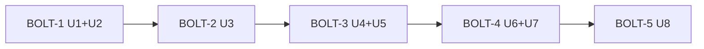

# Tasks — tui-software-color

## 2.9 Delivery plan

**Verification command (aprovado em 2026-11-17):** `test -z "$(gofmt -l .)" && go vet ./... && go test -race ./... && just english-check` (= `just check` + `just english-check`). Exit 0 verifica uma Unit. Verificações manuais no hardware real (visual) ficam registradas em `construction/build-and-test.md`.

**Walking skeleton:** UNIT-1 (`dusk reset-gamma` ponta a ponta no Mutter real).

Caption: bolts sequenciais, Units em ordem topológica (iteração unit-major).

### BOLT-1 — Units: UNIT-1, UNIT-2 — Owner: Lucas + Claude
DoD: verificação exit 0; `dusk reset-gamma` restaura identidade nos 3 monitores reais; config atual do usuário passa em `check-config`.
### BOLT-2 — Units: UNIT-3
DoD: verificação exit 0; teste manual: cor noturna e brilho por software aplicados no DP-1 e restaurados no `stop`; 0 chamadas a `ddcutil` em regime (NFR-2).
### BOLT-3 — Units: UNIT-4, UNIT-5
DoD: verificação exit 0; `reset-ddc` testado com fake e (com OK explícito) em 1 monitor real; `dusk` abre a TUI com Status ao vivo.
### BOLT-4 — Units: UNIT-6, UNIT-7
DoD: verificação exit 0; fluxo completo de edição → salvar → reload no hardware real.
### BOLT-5 — Units: UNIT-8 (NFR-8: `just english-check` na verificação)
DoD: verificação exit 0; workflow de CI criado; README e memória atualizados.

## Tasks

### UNIT-1 Gamma e backend Mutter   Status: verified (2026-11-17, exit 0)
Resumo: `internal/gamma` (Ramp, Identity, Build, BrightnessScale, Reset, interface Backend), `internal/gamma/gammatest` (fake), `internal/gamma/mutter` (godbus sobre `Conn`), `cmd/dusk/gamma.go` (`dusk reset-gamma`), `go.mod` (+godbus/dbus v5.2.4, +x/sys). Executar: `./bin/dusk reset-gamma`. Resultado: verificação aprovada exit 0; `reset-gamma` real nos 3 monitores (DP-1, DP-3, HDMI-1) exit 0.
Desvios: (1) `GetResources` real devolve 6 valores (inclui max W/H), corrigido após o teste real; (2) `justfile`: `english-check` ignora a linha `// Author:` do cabeçalho obrigatório (contém "ú"); (3) T-1.5 sem entrada em `dusk list`, adiado para UNIT-2 (reescreve `list`); (4) o nome da saída do Mutter para o LG é `HDMI-1`, enquanto o ddcutil diz `card1-HDMI-A-1`: o casamento por conector (ADR-16, A7) precisa normalizar (UNIT-2).
- [x] T-1.1 Pacote `gamma`: `Ramp`, `Identity`, `Build`, `BrightnessScale` puros — FR-1, FR-2 — teste: tabela (clamp, monotonia, piso, 1024 pontos).
- [x] T-1.2 `gamma.Backend` + `gammatest` fake — NFR-5 — teste: round-trip Get/Set no fake.
- [x] T-1.3 `gamma/mutter`: `Outputs`, `Get`, `Set` com godbus atrás de interface de conexão mockável; sem Mutter retorna `ErrNoBackend` com mensagem clara — FR-6, NFR-7 — teste: fake de conexão D-Bus, parse de `GetResources`, ausência do serviço.
- [x] T-1.4 `Watch` do sinal `MonitorsChanged` — FR-6 — teste: sinal injetado.
- [x] T-1.5 `dusk reset-gamma` e entrada em `list` — FR-4 — teste: CLI com backend fake; manual: 3 monitores.

### UNIT-2 Config e identidade de monitor   Status: verified (2026-11-17, exit 0)
Resumo: `config` (+`brightness`, `floor`, validação com caminho do campo, `Marshal` emite só o que difere do padrão), `config/testdata/legacy-2026-11-13.toml` (seriais fictícios), `monitors/resolve.go` (`Resolve`, `NormalizeConnector`), `cmd/dusk/main.go` (`list` com seção de telas, DDC opcional), `cmd/dusk/gamma_test.go` (TestMain isola o D-Bus). Resultado: verificação exit 0; no hardware real `dusk list` casou os 3 monitores com config e barramento DDC; `check-config` do config real ok.
Desvios: (1) o aviso de `fallback` ignorado nasce na UNIT-4 (hoje o fallback ainda funciona); (2) fixtures de teste existentes receberam `Brightness`/`Floor` (Marshal espera config normalizada); (3) `dusk setup` ainda não preserva `brightness`/`floor` ao regravar (setup sai na UNIT-4).
- [x] T-2.1 `config`: `brightness`, `floor`, `fallback` ignorado com aviso; validação com caminho do campo — FR-16 — teste: tabela de válidos/inválidos, config de 2026-11-13.
- [x] T-2.2 `Marshal` com novos campos (round-trip) — FR-10 — teste: Parse(Marshal(x)) == x.
- [x] T-2.3 `monitors`: casar config ↔ `gamma.Output` ↔ `ddc.Display` por conector/nome (ADR-16) — FR-5 — teste: casos AOC, LG sem serial, sem DDC.

### UNIT-3 Controller por software   Status: verified (2026-11-17, exit 0)
Resumo: `internal/controller` reescrito (gama por monitor, piso, passos de 1 ponto, reaplicação por verificação de 1 min + evento de hotplug/retomada, pausa restaura a identidade, Shutdown restaura identidade e brilho DDC original, brilho `ddc` só VCP 0x10), `internal/gamma/lazy.go` (conexão tardia ao Mutter), `gammatest` (+History), `ipc`/`daemon`/`printStatus` com o novo status (gamma, scale, output, warnings), testes novos (15 no controller; 7 mutantes, 1 sobrevivente real virou teste). Resultado: verificação exit 0; teste real no hardware: 3 monitores com R100 G89 B60 (fase de entrada do modo noturno), brilho 18% (escala 26%), `stop` restaurou as telas, DDC não foi tocado.
Desvios: (1) o controller já abandona `nightlight`/`state.json` aqui (UNIT-4 só apaga os pacotes); (2) `verify_interval` continua só para DDC (A17); (3) observação de uso: o brilho agendado (15–30%) vira escala de 26% no sinal, mais escuro que o backlight a 18%; avaliar piso maior ou `brightness = "ddc"` por monitor.
- [x] T-3.1 Controller usa `gamma.Backend`; calcula rampa por monitor (cor × escala) — FR-1, FR-2 — teste: relógio injetado, rampa esperada.
- [x] T-3.2 Brilho DDC opcional só 0x10, restaura original ao parar — FR-3 — teste: fake Display registra VCPs escritos (só 0x10).
- [x] T-3.3 Reaplicação: `Watch` + verificação periódica; aviso de Night Light ligado — FR-6 — teste: rampa alterada externamente volta ao alvo.
- [x] T-3.4 `Shutdown` e `pause` restauram identidade — FR-4 — teste: rampa == identidade após Shutdown.
- [x] T-3.5 Passo suave e backoff em falha D-Bus — NFR-3, NFR-4 — teste: falha injetada não derruba o laço.
- [x] T-3.6 Status/IPC/daemon estendidos; `printStatus` — FR-17 — teste: JSON e saída de texto.
- [x] T-3.7 Zero chamadas DDC em regime só-software — NFR-2 — teste: contador do Runner fake.

### UNIT-4 Legado, reset-ddc e serviço   Status: verified (2026-11-17, exit 0)
Resumo: removidos `internal/nightlight`, o campo/validação `fallback` (o TOML aceita a chave com aviso em `Config.Warnings`, mostrado por `check-config` e no status), o night light do `preflight`/`setup`; `state` virou leitura legada; novos `internal/legacy` + `dusk reset-ddc [--yes] [--to-max]`, `internal/service` (State/Start/Stop; `dusk start` usa), unit systemd com `ExecStopPost=<bin> reset-gamma` (com aspas). Resultado: verificação exit 0. No hardware real só leitura (`reset-ddc` com resposta "n" a tudo): os 3 monitores estão em 50/50/50 e não há original salvo. Nenhuma escrita DDC foi feita no hardware.
Desvios: (1) `setup`/`prompt` ficam para a UNIT-5 (quando `dusk setup` virar a TUI); (2) a suposição A19 caiu: sem original salvo não se assume 100%, só com `--to-max`.
- [x] T-4.1 Remover `nightlight`, `setup`, `prompt` e escrita de `state.json` — FR-7 — teste: build + testes restantes; `ddcutil` ausente não impede o start.
- [x] T-4.2 `legacy.ResetDDC` + `dusk reset-ddc` com confirmação — FR-8 — teste: sem confirmação 0 escritas; com, 0x16/18/1A restaurados (fake).
- [x] T-4.3 `internal/service` (start/stop/status/install/uninstall) — FR-12 — teste: Runner fake de systemctl.
- [x] T-4.4 Unit com `ExecStopPost=reset-gamma`; preflight com `ddcutil` opcional — FR-7, ADR-12 — teste: `RenderUnit` golden.

### UNIT-5 TUI núcleo e Status   Status: verified (2026-11-17, exit 0)
Resumo: `internal/tui` (Bubble Tea v1.3.10 + Lip Gloss v1.1.0): `Client`/`IPCClient`, `Model` com abas 1-4, cabeçalho com estado/noite, aba Status ao vivo (poll 1 s, respostas atrasadas descartadas), ajuda, teclas p/r/?/q, tela "too small", estado "stopped"; `cmd/dusk/tui.go` (`dusk` sem args em terminal abre a TUI; sem terminal imprime o usage). Dependências novas: bubbletea, lipgloss, x/term (diretas). Resultado: verificação exit 0 (16 testes novos do tui, 3 do roteamento). Teste real num pseudo-terminal 80x24: renderiza o estado "stopped", troca para a aba 2 e sai com `q`.
Desvios: (1) `dusk setup` alias da TUI e remoção de `internal/setup` passam para UNIT-6 (T-6.5), `internal/prompt` fica porque o `install` o usa; (2) indicadores do cabeçalho em ASCII `(*) (=) (x)` porque `english-check` proíbe não-ASCII; (3) sem terminal que responda às consultas de cor/cursor o Bubble Tea espera — normal em terminais reais.
- [x] T-5.1 Dependências Bubble Tea/Bubbles/Lip Gloss; `internal/tui` modelo, abas, ajuda, 80x24 — FR-9, NFR-6 — teste: `Update`/`View` com mensagens.
- [x] T-5.2 Cliente IPC com estado "daemon parado" e polling ≤ 1 s — FR-9 — teste: fake de cliente.
- [x] T-5.3 Aba Status (tabela, fase da noite, avisos, pause/resume/reload) — FR-9 — teste: View golden.
- [x] T-5.4 `dusk` sem args em TTY abre a TUI — FR-15 — teste: roteamento do `main`. (`setup` como alias da TUI passa para T-6.5.)

### UNIT-6 TUI Monitors e Night   Status: verified (2026-11-17, exit 0)
Resumo: `config.Validate/Write` (valida, backup `.bak-<ts>`, grava atômico), `internal/tui` (`form`, `editing`, `monitors`, `configio`): aba Monitors (lista, editor com nome/match/backend/piso/nível RGB/agenda, adicionar a partir de tela sem entrada, remover com `y`), aba Night, criação da config do zero a partir das telas detectadas (`n`), validação por campo + erro cruzado do `config.Parse`, `Ctrl+S`/`Esc`, `reload` ao salvar; `dusk setup` agora abre a TUI; removidos `internal/setup` e `internal/preflight`; `dusk install` sem config explica e não altera nada. Resultado: verificação exit 0 (~25 testes novos do tui, 4 do config.Write). Teste real em pty com `XDG_CONFIG_HOME` temporário: `n` criou a config com as 3 telas reais e o `check-config` aprovou; o `config.toml` do usuário não foi tocado.
Desvios: (1) FR-14 (prévia ao vivo, Could) não entregue, no backlog; (2) edição de texto própria, sem `bubbles` (A22); (3) um teste meu da UNIT-5 era instável (iteração de `map`) e foi corrigido.
- [x] T-6.1 Aba Monitors: lista e editor (nome, backend, piso, nível RGB) — FR-10 — teste: edição → config esperada.
- [x] T-6.2 Editor de agenda (adicionar/editar/remover pontos) — FR-10 — teste: pontos ordenados e validados.
- [x] T-6.3 Aba Night (habilitar, início, fim, rampa, níveis) — FR-11 — teste: campos → config.
- [x] T-6.4 Salvar: validar, gravar atômico, backup, `reload`; erro no campo — FR-13 — teste: inválido não grava; backup criado.
- [x] T-6.5 `dusk setup` vira alias da TUI e `internal/setup` é removido (a TUI já cria a config do zero) — FR-7, FR-15 — teste: roteamento e build sem o pacote.
- [S] T-6.6 (Could) Prévia ao vivo via IPC `preview` com TTL — FR-14 — **não entregue**: adiada para o backlog por decisão do usuário no gate da UNIT-6 — teste: expira, nunca grava.

### UNIT-7 TUI Service e Logs   Status: verified (2026-11-17, exit 0)
Resumo: `internal/tui/service.go` (aba Service: estado, instalar, desinstalar com `y`, iniciar, parar, logs com rolagem, reset DDC com lista somente leitura + `y` por item + `m` para permitir 100% sem original), adaptadores reais em `cmd/dusk/tuiadapters.go` (`cliService`, `cliReset`), testes com serviço e reset falsos (~16) e dos adaptadores (4). Resultado: verificação exit 0. Teste real em pty (somente leitura): aba 4, logs e lista do reset DDC aparecem; os 3 monitores seguem em 50/50/50, sem escrita.
Desvios: (1) o layout do reset DDC foi compactado para caber em 80 colunas (os testes revelaram o corte); (2) mensagens de dica da CLI foram filtradas do resultado do Install na TUI.
- [x] T-7.1 Aba Service: instalar/desinstalar/iniciar/parar/pausar — FR-12 — teste: serviço fake.
- [x] T-7.2 Logs com rolagem (journalctl) — FR-12 — teste: viewport com fake.
- [x] T-7.3 Reset DDC com confirmação `y/n` por monitor — FR-8, FR-12 — teste: nega → 0 escritas.

### UNIT-8 CI e documentação   Status: verified (2026-11-17, exit 0)
Resumo: `.github/workflows/ci.yml` (checkout, setup-go com `go-version-file`, setup-just, `just check`, `just english-check`), `README.md` reescrito (software vs DDC, TUI, comandos, configuração, como funciona, migração com `reset-ddc`, solução de problemas), codekb refrescado, memórias M-004/M-005 já gravadas (M-002 aposentada). Resultado: verificação exit 0.
Desvios: (1) o workflow não foi executado no GitHub (sem push); (2) existe `docs/img/dusk.jpeg` (1,9 MB) criado durante a sessão, que não é meu: não foi referenciado nem versionado.
- [x] T-8.1 `.github/workflows/ci.yml` (`just check`, `just english-check`) — FR-18 — verificação: arquivo válido, passos corretos.
- [x] T-8.2 README: software vs DDC, TUI, migração, `reset-ddc` — FR-19 — `just english-check`.
- [x] T-8.3 Atualizar memórias (M-002) e codekb — FR-7 — revisão manual.

### Assumptions & open questions
- A14: CI usa `ubuntu-latest` com Go 1.26 e `just`; testes não precisam de D-Bus nem de monitor. [inferred]
