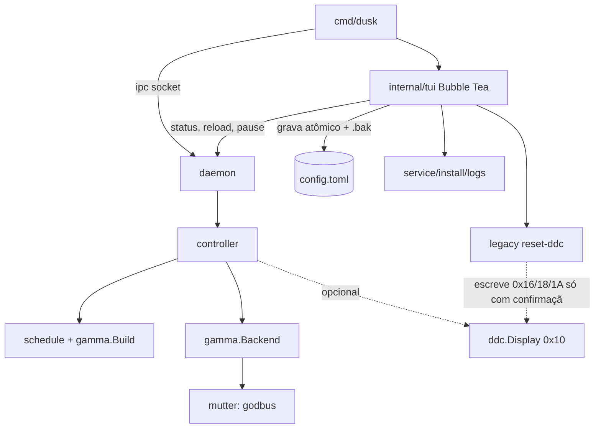

# Architecture — DUSK
Status: draft · Confidence: high

Binário Go único (daemon + CLI + TUI). Núcleo puro (`config`, `schedule`, `gamma.Build`) e portas injetáveis (`gamma.Backend`, `ddc.Display`, `tui.Client/ConfigStore/Service/DDCReset`). [src: internal/controller/controller.go:37, internal/tui]

Caption: `ddc` só entra se algum monitor usa `brightness = "ddc"`; o caminho normal não chama `ddcutil`.

- Concorrência: um goroutine por monitor por tick; `Display` serializa por mutex. [src: controller.go Tick]
- Reaplicação: verificação de 1 min + evento `MonitorsChanged` + Resume; aviso após 3 divergências em 10 min. [src: controller.go]
- Decisões: ADR-10..16 em `.aidlc/261117-tui-software-color/design.md`.
