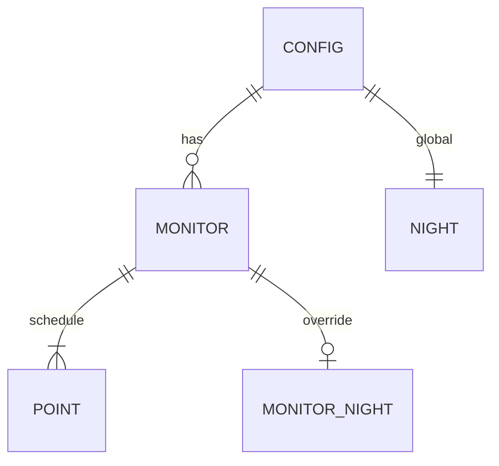

# Data model — DUSK
Status: draft · Confidence: high

Sem banco. Arquivos: `~/.config/dusk/config.toml` (usuário/TUI; backup `.bak-<ts>` a cada gravação), `~/.local/state/dusk/state.json` (só leitura; originais RGB de versões antigas), `$XDG_RUNTIME_DIR/dusk.sock` (socket), `~/.config/systemd/user/dusk.service`.

Caption: entidades do `config.toml`; `Monitor` ganhou `brightness` e `floor`.
