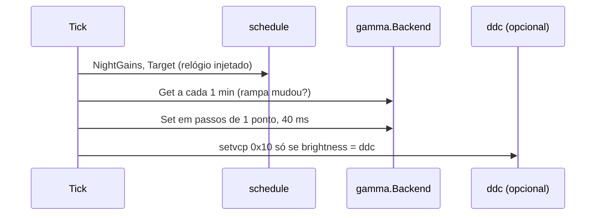

# Interactions — DUSK
Status: draft · Confidence: medium

Caption: laço principal; zero chamadas DDC com backend software. Shutdown/pausa: identidade nas rampas; `ExecStopPost=reset-gamma` cobre crash. [src: controller.go, install.go]
