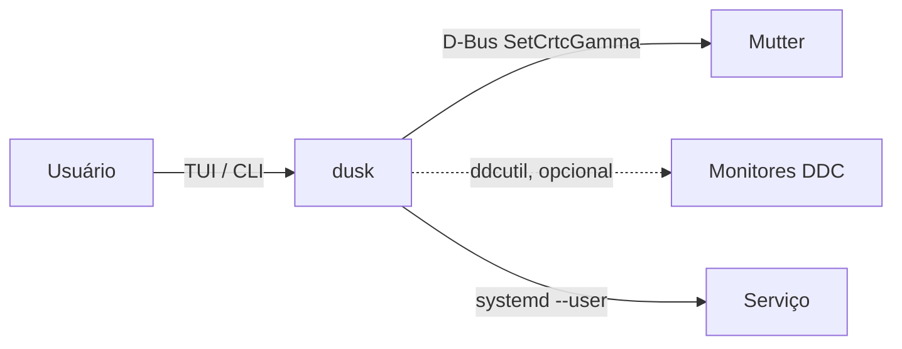

# Overview — DUSK
Status: draft · Confidence: high

**Propósito.** `dusk` agenda brilho e aplica um modo noturno gradual por monitor no Linux, **por software** (rampa de gama do Mutter), sem deixar estado no monitor; brilho DDC é opcional por monitor. Interface principal: TUI (`dusk`). [src: README.md, .aidlc/261117-tui-software-color/requirements.md]

**Usuário.** Um usuário conhecido, 3 monitores (AOC 24G4, LG ULTRAWIDE, Samsung LF24T450F), Ubuntu GNOME Wayland, NVIDIA RTX 4060. Repositório público, tudo em inglês (M-003). [user]

**Capacidades.** Agenda por pontos horários por monitor · modo noturno com rampa e nível RGB por monitor · piso de brilho por software · brilho DDC opcional (só 0x10) · reaplicação quando outro programa troca a rampa · TUI com Status, Monitors, Night e Service (instalar, logs, reset DDC) · CLI de controle · serviço systemd com `ExecStopPost=reset-gamma`. [src: cmd/dusk/main.go, internal/tui]

**Glossário.**

| Termo | Significado | Onde |
|---|---|---|
| Rampa (gamma ramp) | tabela por canal (1024 entradas) por CRTC | internal/gamma/gamma.go |
| Ganho (gain) | percentual da cor cheia por canal no pico da noite | internal/schedule/schedule.go |
| Piso (floor) | brilho mínimo por software, 0-50% | internal/config/config.go |
| Backend de brilho | `software` (escala da rampa) ou `ddc` (VCP 0x10) | config.Monitor.Brightness |
| reset-gamma / reset-ddc | volta a rampa à identidade / restaura ganhos RGB gravados por versões antigas | cmd/dusk |

Caption: contexto do sistema.
